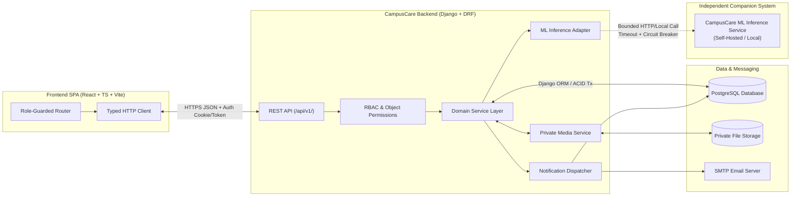
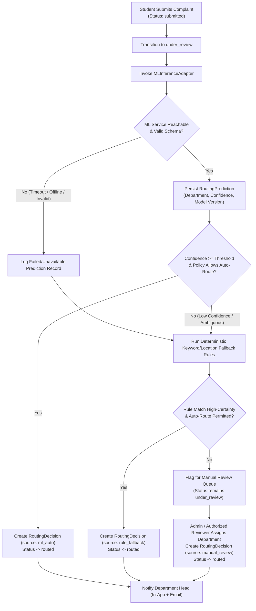
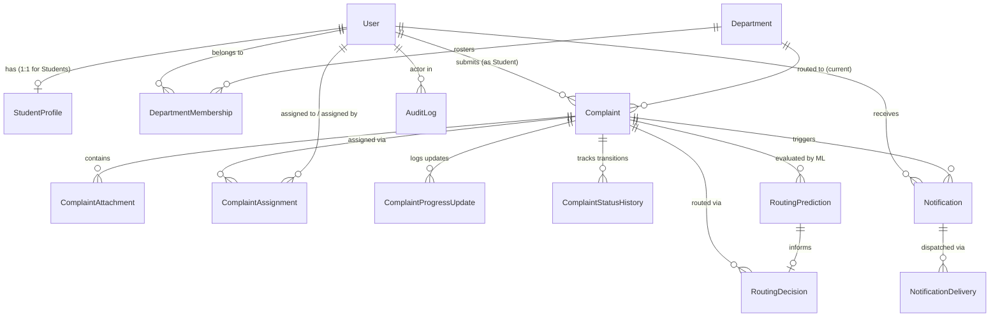
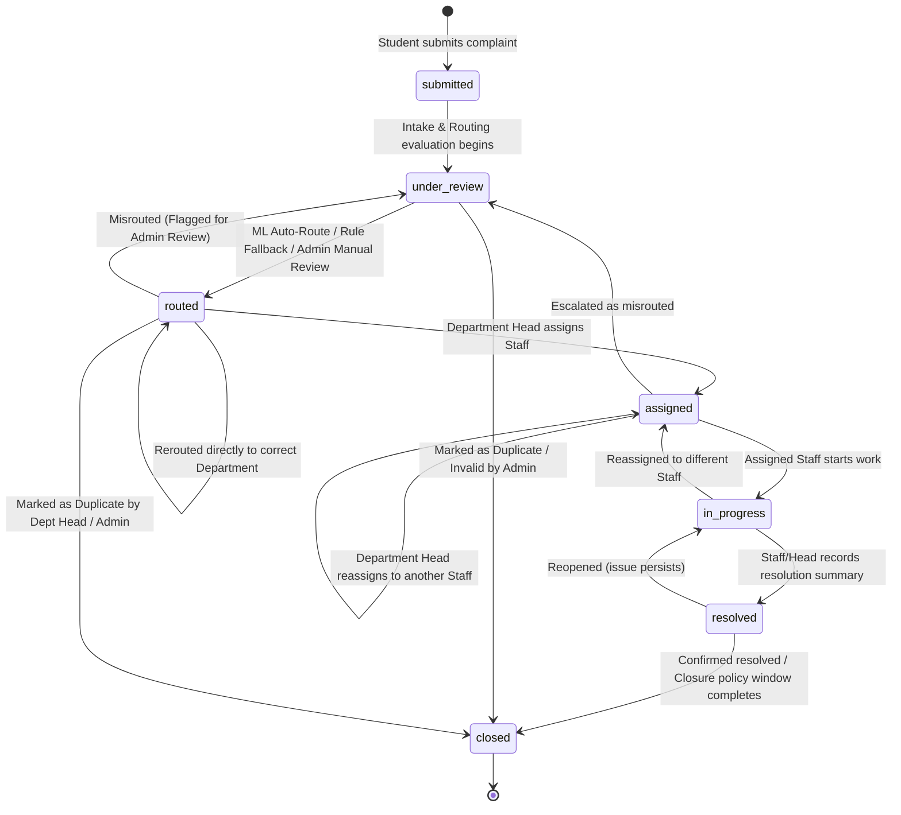
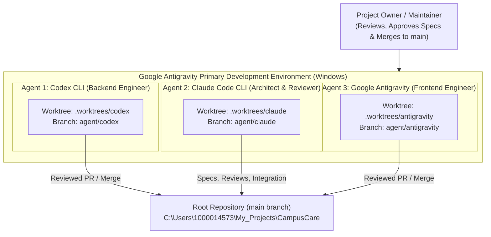

# CampusCare — Multi-Agent Engineering Governance & System Architecture Specification (`AGENTS.md`)

**Project:** CampusCare — Centralized, AI-Assisted University Complaint Management Platform  
**Institution Context:** University of Central Asia (UCA), Naryn Campus  
**Repository:** `https://github.com/meahmadkarim/CampusCare`  
**Canonical Local Path:** `C:\Users\1000014573\My_Projects\CampusCare`  
**Companion ML Local Path:** `C:\Users\1000014573\My_Projects\CampusCare-ML` *(Independent Repository — Read-Only / Do Not Modify)*  
**Primary Branch:** `main`  
**Development Environment:** Windows, Google Antigravity IDE, OpenAI Codex CLI, Anthropic Claude Code CLI  
**Document Role:** Authoritative Multi-Agent Operating Manual, Technical Architecture Guide, and Engineering Governance Standard

---

## Table of Contents

1. [Document Governance, Purpose, and Repository Alignment](#1-document-governance-purpose-and-repository-alignment)
2. [Project Overview and Domain Model](#2-project-overview-and-domain-model)
3. [Technology Architecture (Confirmed vs. Proposed)](#3-technology-architecture-confirmed-vs-proposed)
4. [Independent CampusCare ML Integration Architecture](#4-independent-campuscare-ml-integration-architecture)
5. [Complete Backend Architecture (Django + DRF)](#5-complete-backend-architecture-django--drf)
6. [Complete Database Architecture (Proposed PostgreSQL Schema)](#6-complete-database-architecture-proposed-postgresql-schema)
7. [User Roles, Access Control, and Permission Matrix](#7-user-roles-access-control-and-permission-matrix)
8. [Complaint Lifecycle and State Machine Design](#8-complaint-lifecycle-and-state-machine-design)
9. [REST API Architecture and Endpoint Design (`/api/v1/`)](#9-rest-api-architecture-and-endpoint-design-apiv1)
10. [Complete Frontend Architecture](#10-complete-frontend-architecture)
11. [Security, Privacy, and Institutional Compliance](#11-security-privacy-and-institutional-compliance)
12. [Multi-Agent Development System and Roster](#12-multi-agent-development-system-and-roster)
13. [Git and Worktree Governance](#13-git-and-worktree-governance)
14. [Professional Agent Handoff System (`docs/handoffs/`)](#14-professional-agent-handoff-system-docshandoffs)
15. [Centralized Task Tracking System (`TASKS.md`)](#15-centralized-task-tracking-system-tasksmd)
16. [Testing Strategy and Quality Assurance](#16-testing-strategy-and-quality-assurance)
17. [Deployment, Operations, and Release Procedures](#17-deployment-operations-and-release-procedures)
18. [Phased Development Roadmap (Phases 0–10)](#18-phased-development-roadmap-phases-010)
19. [Project Documentation Structure](#19-project-documentation-structure)
20. [Definition of Done (DoD)](#20-definition-of-done-dod)
21. [Mandatory Agent Operating Rules](#21-mandatory-agent-operating-rules)

---

## 1. Document Governance, Purpose, and Repository Alignment

### 1.1 Purpose of `AGENTS.md`
This document is the primary engineering handbook and operational constitution for **all AI coding agents** (Google Antigravity, OpenAI Codex CLI, and Claude Code CLI) and human developers working on **CampusCare**. It is written so that any newly initialized agent session can understand the complete product domain, proposed system architecture, database schema, API contracts, security invariants, Git worktree topology, handoff protocols, and phased roadmap without relying on prior chat transcripts.

### 1.2 Authority Hierarchy
To prevent architectural drift or unauthorized assumptions, CampusCare separates **process governance** from **approved product specification**:

1. **Project Owner / Maintainer Explicit Instructions:** Direct instructions from the project owner override any default recommendation.
2. **`PROJECT_SPEC.md` (Planned Authority for Product & Architecture Decisions):** Once created and signed off by the project owner, `PROJECT_SPEC.md` is the canonical source of truth for finalized functional requirements, approved database schemas, state transitions, and technology choices.
3. **`AGENTS.md` (This Document — Authority for Agent Operations & Proposed Technical Design):** Governs agent behavior, worktree boundaries, security standards, testing discipline, handoff procedures, and documents the comprehensive proposed technical architecture pending formal ratification in `PROJECT_SPEC.md`.
4. **`TASKS.md` (Planned Authority for Work Execution):** Tracks active, queued, blocked, and completed engineering tasks across all agents and worktrees.
5. **`README.md` & `docs/`:** Public-facing project overview and specialized technical sub-documentation (`docs/architecture/`, `docs/database/`, `docs/api/`, `docs/decisions/`, `docs/handoffs/`, `docs/testing/`, `docs/deployment/`).

### 1.3 Confirmed Product Requirements vs. Proposed Implementation Choices
Agents must **never silently finalize undecided architecture**. Throughout this document, every requirement and technical detail is strictly categorized as:
- **[CONFIRMED REQUIREMENT]:** Core domain rules, user roles, departments, workflows, security mandates, and repository constraints approved by the project owner.
- **[PROPOSED ARCHITECTURE / RECOMMENDATION]:** Detailed technical recommendations (specific frameworks, database tables, field definitions, API payload shapes, and UI component layouts) designed to satisfy confirmed requirements, awaiting explicit sign-off in `PROJECT_SPEC.md`.

### 1.4 Reconciliation of Existing Repository Documentation Conflicts
An inspection of the existing repository files (`README.md` and `docs/ROADMAP.md`) identified several discrepancies that agents must be aware of and handle consistently:

| Area | Existing File Reference | Conflict / Discrepancy | Authoritative Resolution in `AGENTS.md` |
| :--- | :--- | :--- | :--- |
| **Development Roadmap Phases** | `docs/ROADMAP.md` defines 7 phases where Phase 2 builds Student UI *before* Phase 3 builds Backend/Database. | Implementing frontend workflows before backend models, authentication, and API contracts causes rework and contract mismatch. | Follow the **11-Phase Roadmap (Phases 0–10)** in Section 18 of this document (Architecture & Contracts → Backend Foundation → Auth/Roles → Complaints → Frontend → Integration → Notifications → ML → QA → Deployment). `docs/ROADMAP.md` will be aligned only when authorized. |
| **Complaint Status Lifecycle** | `docs/ROADMAP.md` (Phase 4) lists a simplified 4-stage flow: `Pending → Assigned → In Progress → Resolved`. | Omits intake review, routing verification, and final closure stages required for hybrid ML/human routing and auditability. | Use the **7-stage proposed lifecycle** (`submitted → under_review → routed → assigned → in_progress → resolved → closed`) documented in Section 8, pending formal ratification in `PROJECT_SPEC.md`. |
| **Student Department Selection** | `docs/ROADMAP.md` (Phase 2) lists a "Department selection dropdown" on the student submission form, whereas `README.md` states students should not have to determine which office handles an issue. | Ambiguity over whether students submit blind to routing or may optionally suggest a department. | Automated/assisted routing is the confirmed core mechanism. Whether students may optionally supply a non-binding "suggested department" hint is flagged as an open product decision for `PROJECT_SPEC.md`. |
| **CampusCare ML Location** | `README.md` notes the GitHub URL `github.com/meahmadkarim/campuscare-ml` as "Planned — not yet verified/published". | Does not mention the active local filesystem path. | The independent ML project exists locally at `C:\Users\1000014573\My_Projects\CampusCare-ML`. Agents working on CampusCare must **never** modify files in `CampusCare-ML`. |
| **Frontend Framework Status** | `README.md` lists `React, TypeScript, Vite (or Django Templates)` as proposed. | Leaves open whether the UI is an SPA or server-rendered templates. | `React + TypeScript + Vite` communicating via `/api/v1/` REST endpoints is the primary recommended architecture (Sections 3, 9, 10), while remaining formally marked as a proposal until approved in `PROJECT_SPEC.md`. |
| **Staff Meeting Logs** | `docs/ROADMAP.md` (Phase 4) mentions "Create staff minutes and meeting logs". | Not part of the core CampusCare complaint lifecycle defined in `README.md` or architectural specifications. | Treat "staff minutes and meeting logs" as out-of-scope / unconfirmed unless explicitly added to `PROJECT_SPEC.md`. |

---

## 2. Project Overview and Domain Model

### 2.1 Institutional Context and Mission `[CONFIRMED REQUIREMENT]`
**CampusCare** is a centralized, AI-assisted complaint management system designed for the **University of Central Asia (UCA), Naryn Campus**. It replaces fragmented, informal reporting channels (ad-hoc emails, walk-ins, messaging apps) with a unified, transparent, and fully auditable platform where students report campus issues and university departments route, assign, track, and resolve them.

> **Institutional Disclaimer:** CampusCare is an independent software engineering project modeled around UCA Naryn campus operations. Real university deployment requires formal institutional approval, IT security clearance, and administrative sign-off.

### 2.2 Confirmed User Roles `[CONFIRMED REQUIREMENT]`
CampusCare supports exactly **four core user roles**:

1. **Student:** Authenticated university students who submit text-only or photo-assisted complaints, monitor status transitions, view authorized progress updates and resolution summaries, and receive notifications regarding their own submissions.
2. **Department Head:** The operational leader of a specific university department who receives dashboard and email alerts for complaints routed to their department, reviews incoming issues, requests rerouting if misrouted, assigns or reassigns complaints to eligible staff members within their department, and monitors departmental resolution performance.
3. **Department Staff:** Operational personnel within a specific department who view complaints explicitly assigned to them by their Department Head, perform remediation work, record student-visible progress updates and internal staff notes, transition complaint work states, and document final resolution details.
4. **Administrator:** System-wide oversight personnel responsible for managing user accounts, role assignments, and department records; monitoring platform-wide complaint metrics; reviewing low-confidence or failed ML routing predictions; performing manual routing corrections; and auditing system-wide activity logs.

### 2.3 Confirmed University Departments `[CONFIRMED REQUIREMENT]`
CampusCare supports **five canonical campus departments** at UCA Naryn:

| # | Department Name | Proposed Slug / Code | Operational Scope & Example Issues |
| :- | :--- | :--- | :--- |
| 1 | **Maintenance & Facilities** | `maintenance-facilities` | Broken classroom or dormitory furniture (e.g., broken classroom chairs, desks), plumbing leaks, heating/HVAC issues, lighting outages, doors/windows, electrical sockets, and physical building upkeep. |
| 2 | **IT Department** | `it` | Campus Wi-Fi dead zones, Ethernet outages, computer lab hardware/software failures, smartboard/projector malfunctions, institutional email/account access, and LMS/network issues. |
| 3 | **Security** | `security` | Campus safety hazards, malfunctioning electronic access cards/turnstiles, unauthorized building entry concerns, lost-and-found security incidents, and emergency lighting/camera issues. |
| 4 | **Academic Administration** | `academic-administration` | Classroom scheduling conflicts, registrar inquiries, examination room logistics, course registration issues, and academic facility resource allocation. |
| 5 | **Student Affairs** | `student-affairs` | Dormitory residential life policies, roommate/common-area concerns, campus dining/cafeteria feedback, student club facility requests, and student welfare services. |

### 2.4 Confirmed Core Functional Capabilities `[CONFIRMED REQUIREMENT]`
1. **Student Authentication:** Secure registration, login, logout, and session/token management for students and university personnel.
2. **Text-Only Complaints:** Structured submission of written complaint titles, detailed descriptions, and campus location metadata.
3. **Complaints with Optional Photographs:** Support for attaching one or more optional digital photographs (e.g., a photo of a broken chair or error screen) with strict file validation and private storage.
4. **Centralized Complaint Management:** Single relational system of record for all campus complaints from submission to closure.
5. **AI-Assisted Classification:** Automated department classification via an adapter to the independent, self-hosted **CampusCare ML** inference system.
6. **Automatic Department Routing (When Permitted by Policy):** High-confidence predictions that pass policy and validation checks automatically route the complaint to the predicted department.
7. **Manual Routing Review and Correction:** Low-confidence predictions, ML unavailability, rule conflicts, or misrouted complaints are placed into a manual review queue or rerouted by authorized humans (Administrators / Department Heads).
8. **Department Head Notifications (Dashboard & Email):** Immediate in-app dashboard notifications and SMTP email alerts sent to the responsible Department Head upon complaint routing or escalation.
9. **Department Head Staff Assignment:** Department Heads assign incoming departmental complaints to specific eligible Department Staff members within their department.
10. **Staff Progress Updates:** Assigned staff members record structured progress updates (distinguishing student-visible updates from internal departmental notes).
11. **Complaint Status Tracking:** End-to-end lifecycle tracking visible to the submitting student (for authorized fields) and departmental/administrative staff.
12. **Resolution Management:** Structured recording of resolution summaries, timestamps, and resolving staff metadata before closure.
13. **Administrative Oversight:** Cross-departmental monitoring, user/role administration, routing exception handling, and operational reporting.
14. **Complaint History and Audit Trails:** Immutable chronological history of every status change, assignment, routing prediction/decision, and security-sensitive action.
15. **Secure Role-Based Access Control (RBAC):** Strict server-side authorization enforcing role, ownership, department membership, and assignment boundaries.

### 2.5 End-to-End Reference Workflow (Broken Classroom Chair Example) `[CONFIRMED REQUIREMENT]`
Every subsystem in CampusCare must cohesively support the following canonical operational flow:

1. **Submission:** A student logs into CampusCare and reports a broken classroom chair in Academic Block Room 204, providing a written description and attaching an optional photograph of the damaged chair.
2. **Persistence & Intake:** The backend validates the text and image, stores the image in private media storage, creates the complaint record with initial status `submitted`, and records an initial status history and audit log entry within an atomic database transaction.
3. **Routing & Classification:** The Routing Service evaluates the complaint (`under_review`), invokes the **CampusCare ML** inference adapter (or deterministic fallback rules if ML is unavailable), records the `RoutingPrediction` (including model version and confidence score), and determines **Maintenance & Facilities** as the responsible department. A `RoutingDecision` record is persisted, and the complaint transitions to `routed`.
4. **Department Head Notification:** The Notification Service creates an in-app dashboard notification and dispatches an email alert to the **Maintenance & Facilities Department Head**, logging delivery status in `NotificationDelivery`.
5. **Staff Assignment:** The Maintenance & Facilities Department Head reviews the complaint on their Department Dashboard and assigns it to an authorized Maintenance staff member ( carpenter / technician). A `ComplaintAssignment` record is created, the complaint transitions to `assigned`, the assigned staff member is notified, and an audit entry is written.
6. **Remediation & Progress Updates:** The assigned staff member inspects and repairs/replaces the chair, transitions the complaint to `in_progress`, logs a student-visible progress update ("Replacement chair ordered and being installed in Room 204"), and finally marks the complaint `resolved` with a resolution summary ("Broken chair replaced and inspected").
7. **Student Monitoring & Closure:** Throughout the process, the student monitors real-time status transitions and reads authorized progress updates on their dashboard without ever seeing internal staff-only notes. Upon verification or policy closure window, the complaint transitions to `closed`.
8. **Administrative Oversight & Auditing:** At any point, an Administrator can inspect cross-departmental metrics, routing accuracy, assignment latencies, and the complete, tamper-evident audit trail of every action taken on the complaint.

---

## 3. Technology Architecture (Confirmed vs. Proposed)

### 3.1 Architectural Governance Matrix
Agents must respect the distinction between confirmed project constraints and proposed implementation choices:

| Layer / Component | Recommended Technology | Governance Status | Notes & Approval Requirement |
| :--- | :--- | :--- | :--- |
| **Backend Language & Framework** | Python 3.11+, Django 5.x, Django REST Framework (DRF) | **Confirmed / Primary Direction** | Core backend framework, ORM, authentication, RBAC, and REST API layer. |
| **Frontend Stack** | React 18+, TypeScript 5+, Vite | **Proposed (Recommended)** | Recommended for rich role-specific dashboards and strict type safety against `/api/v1/` contracts. Requires formal sign-off in `PROJECT_SPEC.md`. |
| **Database Engine** | PostgreSQL 15+ | **Proposed (Recommended)** | Recommended for ACID transactions, relational integrity, indexing, and JSONB audit metadata. |
| **ML Inference System** | Independent CampusCare ML (`C:\Users\1000014573\My_Projects\CampusCare-ML`) | **Confirmed Architectural Constraint** | Must run locally or be self-hosted. Zero runtime dependency on commercial AI APIs (no OpenAI, Gemini, or Anthropic APIs at runtime). |
| **Version Control** | Git, GitHub, Isolated Git Worktrees | **Confirmed Requirement** | Primary `main` branch plus isolated `.worktrees/codex`, `.worktrees/claude`, and `.worktrees/antigravity`. |
| **Development Environment** | Windows, Google Antigravity IDE, Codex CLI, Claude Code CLI | **Confirmed Requirement** | Multi-agent development orchestrated inside Google Antigravity. |

### 3.2 Engineering Justification for Recommended Stack `[PROPOSED ARCHITECTURE]`

1. **Python + Django + Django REST Framework (Backend):**
   - **Security by Default:** Built-in protection against SQL injection (via ORM parameterization), XSS, CSRF, clickjacking, and battle-tested PBKDF2/Argon2 password hashing.
   - **Relational Modeling & Migrations:** Deterministic schema evolution (`makemigrations` / `migrate`) ideal for the 14 interconnected domain models required by CampusCare.
   - **DRF Serialization & Permissions:** Clean separation between request validation (Serializers), role/object-level authorization (`BasePermission` classes), and HTTP transport (APIViews/ViewSets).
   - **Python Ecosystem Alignment:** Native language alignment with the Python-based CampusCare ML project facilitates shared schema definitions and reliable HTTP/local IPC integration.

2. **React + TypeScript + Vite (Frontend):**
   - **Role-Specific Interactive Dashboards:** CampusCare serves four distinct roles with dynamic filtering, status timelines, assignment modals, and notification drawers that benefit from component-driven state management.
   - **Compile-Time Contract Safety:** TypeScript interfaces mirror DRF `/api/v1/` serializer schemas, catching payload mismatches before runtime.
   - **Fast Local Iteration:** Vite provides instant HMR and clean production asset bundling without heavy build complexity.

3. **PostgreSQL (Database):**
   - **Transactional Integrity:** Strict foreign-key enforcement, `CHECK` constraints, row-level locking (`SELECT ... FOR UPDATE` during concurrent assignments/status transitions), and atomic multi-table writes.
   - **Structured Auditability:** Native `JSONB` support allows `AuditLog` and `RoutingPrediction` metadata to be indexed and queried alongside strict relational columns.

4. **Self-Hosted CampusCare ML Integration:**
   - **Data Sovereignty & Privacy:** Student complaints never leave university-controlled or local infrastructure to third-party commercial AI vendors.
   - **Predictable Cost & Offline Resilience:** Eliminates per-token API fees and external network outages, while the backend adapter guarantees graceful fallback when inference is offline.

### 3.3 Why a Modular Django Monolith Instead of Microservices `[PROPOSED ARCHITECTURE]`
CampusCare explicitly **rejects premature microservices** in favor of a **Modular Django Monolith** (with CampusCare ML as the sole external/companion inference boundary):
- **Transactional Consistency:** Creating a complaint, recording its status history, storing routing decisions, enqueueing notifications, and writing audit logs must occur inside coordinated ACID database transactions—avoiding distributed two-phase commits or eventual-consistency bugs.
- **Operational Simplicity:** A university campus deployment requires straightforward maintenance, single-database backups, and unified authentication rather than managing Kubernetes service meshes, distributed tracing, and multiple data stores.
- **Clean Internal Boundaries:** Domain logic is partitioned into cohesive Django apps (`accounts`, `departments`, `complaints`, `routing`, `assignments`, `notifications`, `audit`, `reports`) that communicate via explicit Python service layers, preserving modularity without network serialization overhead.

### 3.4 Inter-Component Communication Architecture `[PROPOSED ARCHITECTURE]`



1. **Frontend ↔ Django REST API:**
   - All client communication occurs over HTTPS against versioned endpoints under `/api/v1/`.
   - Requests carry authentication credentials (HTTP-only session cookies with CSRF tokens or short-lived JWT access tokens, pending `PROJECT_SPEC.md` confirmation) and JSON payloads (or `multipart/form-data` for image uploads).
   - Responses follow a standardized JSON envelope with deterministic HTTP status codes (`200`, `201`, `400`, `401`, `403`, `404`, `409`, `422`, `500`).
   - Protected complaint photographs are **never** served via public static URLs; the frontend requests attachments through an authenticated Django endpoint that verifies user authorization before streaming the file or issuing a short-lived signed response.

2. **Backend ↔ PostgreSQL Database:**
   - All persistence flows through the Django ORM encapsulated by domain service functions and query selectors.
   - Multi-step state mutations (e.g., routing a complaint, assigning staff, updating status + audit log + notification creation) execute inside `django.db.transaction.atomic()` blocks, with `transaction.on_commit()` triggering external side effects (such as SMTP email sending).

3. **Backend ↔ CampusCare ML Inference Adapter:**
   - The `RoutingService` invokes a dedicated `MLInferenceAdapter` interface rather than calling HTTP libraries directly from views or models.
   - The adapter serializes the complaint text (and optional attachment reference if multimodal inference is enabled), enforces a strict connection/read timeout (e.g., 2.0–3.0 seconds), validates the response schema and predicted department slug against active database departments, and returns a normalized `MLPredictionResult` value object.
   - If the ML service is unreachable, times out, returns invalid JSON, or yields a confidence score below the policy threshold, the adapter catches the failure cleanly and triggers the deterministic rule-based / manual-review fallback path without failing the student's complaint submission.

---

## 4. Independent CampusCare ML Integration Architecture

### 4.1 Repository Separation & Strict Non-Modification Mandate `[CONFIRMED REQUIREMENT]`
- **Local Path:** `C:\Users\1000014573\My_Projects\CampusCare-ML`
- **Strict Isolation Rule:** `CampusCare-ML` is an independent project and Git repository. **No agent working in the CampusCare repository may create, edit, delete, or run destructive commands inside `C:\Users\1000014573\My_Projects\CampusCare-ML`.**
- **Separation of Concerns:**
  - **CampusCare ML** owns dataset curation, preprocessing, model architecture, training, evaluation, confidence calibration, model versioning, artifact packaging, and exposing a self-hosted/local inference endpoint.
  - **CampusCare (This Repository)** owns consuming predictions through a strict adapter contract, persisting prediction audit records, applying confidence/policy thresholds, executing fallback rules, providing human review/override interfaces, and managing the operational complaint lifecycle.
- **No Commercial AI APIs:** Neither CampusCare nor CampusCare ML may depend on external commercial AI APIs (such as OpenAI, Google Gemini, or Anthropic Claude APIs) at application runtime. All inference is executed locally or on self-hosted university-controlled infrastructure.

### 4.2 ML Classification and Hybrid Routing Workflow `[PROPOSED ARCHITECTURE]`



### 4.3 Proposed Request and Response Schemas `[PROPOSED ARCHITECTURE]`

#### Inference Request Payload (`POST /internal/v1/predict` on CampusCare ML)
```json
{
  "request_id": "req_9f8e7d6c-5b4a-4321-8765-123456789abc",
  "complaint_id": "cmp_3a2b1c4d-0000-4111-9222-abcdef012345",
  "submitted_at": "2026-11-17T12:00:00Z",
  "title": "Broken desk chair in Room 204",
  "description": "The metal leg of the student chair near the front row in Room 204 is bent and unsafe to sit on.",
  "location_context": {
    "building": "Academic Block",
    "room_or_area": "Room 204"
  },
  "modality": "text_only",
  "attachments": []
}
```
*(Note: When multimodal classification is enabled in future phases, `modality` may be `"multimodal"` and `attachments` may pass local read-only file descriptors or base64/streamed image hashes in accordance with local IPC rules.)*

#### Inference Response Payload (`200 OK`)
```json
{
  "request_id": "req_9f8e7d6c-5b4a-4321-8765-123456789abc",
  "status": "success",
  "model_metadata": {
    "model_name": "campuscare-dept-classifier",
    "model_version": "1.2.0",
    "modality_used": "text_only"
  },
  "prediction": {
    "predicted_department_slug": "maintenance-facilities",
    "predicted_category": "furniture_damage",
    "confidence": 0.94,
    "probabilities": {
      "maintenance-facilities": 0.94,
      "it": 0.02,
      "security": 0.02,
      "academic-administration": 0.01,
      "student-affairs": 0.01
    }
  },
  "inference_latency_ms": 42
}
```

### 4.4 Confidence Handling, Validation, and Model Version Tracking
1. **Strict Schema & Domain Validation:** Before trusting any response from CampusCare ML, the backend adapter validates:
   - `predicted_department_slug` matches one of the 5 active `Department.slug` records in PostgreSQL (`maintenance-facilities`, `it`, `security`, `academic-administration`, `student-affairs`).
   - `confidence` is a valid float within `[0.0, 1.0]`.
   - `model_version` is a non-empty string (persisted on `RoutingPrediction` for model drift auditing and reproducibility).
2. **Configurable Confidence Tiers (Proposed Defaults Pending `PROJECT_SPEC.md` Approval):**
   - **High Confidence (`confidence >= 0.80`):** Eligible for automatic routing (`source = ML_AUTO`) when automatic routing policy is enabled.
   - **Medium / Uncertain Confidence (`0.50 <= confidence < 0.80`):** Prediction is stored as a recommendation, deterministic rules are checked, and the complaint is placed in the **Manual Routing Review Queue** (`under_review`) with the ML suggestion highlighted for the reviewer.
   - **Low Confidence (`confidence < 0.50`):** Flagged as ambiguous; requires human routing decision.
3. **Rule-Based Fallback Engine:**
   - When the ML service is offline, times out, or returns an invalid payload, the backend executes a deterministic, maintainable rule-based classifier (evaluating structured location tags and curated keyword/phrase dictionaries mapped to the 5 departments).
   - If deterministic rules do not produce an unambiguous match, or if policy requires human verification on fallback, the complaint remains in `under_review` and alerts the Administrator routing queue.
4. **Manual Review and Human Override:**
   - Administrators can review any complaint in `under_review` and select the target department (`source = MANUAL_REVIEW`).
   - If a complaint was automatically routed to Department A (e.g., `IT Department`) but the Department Head of Department A determines it belongs to Department B (e.g., `Maintenance & Facilities` because an electrical outlet—not the router—is broken), the Department Head or Administrator can execute a **Routing Override / Reroute** (`source = HUMAN_OVERRIDE`).
   - Every override records the previous department, new department, acting user, mandatory justification reason, and links back to the original `RoutingPrediction` so future CampusCare ML training iterations can learn from human corrections.
5. **Security, Privacy, and Independent Deployment Considerations:**
   - The ML inference endpoint must bind only to localhost (`127.0.0.1`) or an authenticated internal private network interface accessible solely by the CampusCare backend service—never exposed directly to student browsers or the public internet.
   - Student PII (names, emails, student IDs, phone numbers) must **never** be sent in the ML inference request payload; only complaint text, anonymized complaint UUID, location context, and authorized image data may cross the inference boundary.

---

## 5. Complete Backend Architecture (Django + DRF)

### 5.1 Proposed Django Project Directory Structure `[PROPOSED ARCHITECTURE]`
When backend implementation begins (Phase 2), the Django codebase should follow a clean, modular layout inside `backend/`:

```text
CampusCare/
├── AGENTS.md
├── PROJECT_SPEC.md                  # (Planned) Canonical approved specification
├── TASKS.md                         # (Planned) Multi-agent task tracker
├── README.md
├── docs/                            # Architectural, API, DB, handoff, and QA docs
├── backend/                         # (Planned) Django Backend Root
│   ├── manage.py
│   ├── pyproject.toml / requirements.txt
│   ├── config/                      # Project-level configuration & WSGI/ASGI
│   │   ├── settings/
│   │   │   ├── base.py
│   │   │   ├── local.py
│   │   │   ├── test.py
│   │   │   └── production.py
│   │   ├── urls.py                  # Mounts /api/v1/
│   │   ├── wsgi.py
│   │   └── asgi.py
│   ├── apps/
│   │   ├── common/                  # Base models, UUID mixins, custom exceptions, pagination
│   │   ├── accounts/                # Custom User, StudentProfile, Auth, RBAC permissions
│   │   ├── departments/             # Department, DepartmentMembership, roster services
│   │   ├── complaints/              # Complaint, Attachment, ProgressUpdate, StatusHistory
│   │   ├── routing/                 # RoutingService, MLInferenceAdapter, RuleEngine, Decisions
│   │   ├── assignments/             # ComplaintAssignment, workload & delegation logic
│   │   ├── notifications/           # In-app Notification, NotificationDelivery, SMTP adapter
│   │   ├── audit/                   # Immutable AuditLog model & audit recording service
│   │   └── reports/                 # Aggregated read-only selectors for Admin & Dept Heads
│   └── tests/                       # Cross-app integration, permission boundary & E2E API tests
└── frontend/                        # (Planned) React + TypeScript + Vite SPA
```

### 5.2 Object-Oriented Design and Service Layer Pattern `[PROPOSED ARCHITECTURE]`
To prevent "fat views" or brittle "fat models" with hidden Django signal side effects, the backend follows strict **Object-Oriented Domain and Service Layer principles**:

1. **Encapsulation & Single Responsibility:**
   - **API Views / ViewSets (`views.py`):** Handle HTTP transport only—parse request parameters, invoke DRF permission checks, call a domain service or selector, and return a serialized HTTP response. Views must **never** execute direct multi-model ORM mutations.
   - **Serializers (`serializers.py`):** Handle syntactic and structural input validation and output representation formatting.
   - **Domain Services (`services.py`):** Encapsulate business rules, state machine validation, cross-app orchestration, database transactions, audit logging, and notification triggers (e.g., `ComplaintLifecycleService`, `RoutingOrchestrationService`, `StaffAssignmentService`).
   - **Selectors (`selectors.py`):** Encapsulate read queries, permission-scoped queryset filtering (`for_user(user)`), `select_related` / `prefetch_related` optimizations, and reporting aggregations.
   - **Models (`models.py`):** Define relational schema, field-level invariants, `clean()` validation, and cohesive entity properties. Avoid implicit `post_save` signals for business workflows; invoke side effects explicitly in service methods.
2. **Dependency Inversion & Adapter Pattern:**
   - External boundaries (CampusCare ML inference, SMTP email delivery, file storage backends) are abstracted behind Python protocol/base classes (`BaseMLInferenceGateway`, `BaseEmailProvider`). This enables deterministic unit and integration testing using in-memory fakes/mocks without network calls.

### 5.3 Detailed Backend Subsystems and Responsibilities

#### 1. Custom User Model & Authentication (`apps.accounts`)
- Defines a custom `User` model inheriting from `AbstractBaseUser` and `PermissionsMixin` (configured via `AUTH_USER_MODEL = "accounts.User"` before the very first migration).
- Uses UUID primary keys and institutional email addresses as the primary login identifier (`USERNAME_FIELD = "email"`).
- Manages `StudentProfile` records for users with the `STUDENT` role.
- Provides endpoints for login, logout, current-user session inspection (`/api/v1/auth/me/`), password change, and password reset.

#### 2. Role-Based Authorization (`apps.accounts.permissions`)
- Implements composable DRF permission classes (`IsStudent`, `IsDepartmentHead`, `IsDepartmentStaff`, `IsAdministrator`, `IsComplaintOwnerOrAuthorizedDepartmentMember`) backed by a central `AuthorizationPolicy` service.
- Enforces both **endpoint-level** role checks and **object-level** (`has_object_permission`) checks verifying complaint ownership, active department membership, and active staff assignment.

#### 3. Departments & Memberships (`apps.departments`)
- Manages the 5 canonical university departments (`Maintenance & Facilities`, `IT Department`, `Security`, `Academic Administration`, `Student Affairs`).
- Links `Department Head` and `Department Staff` users to departments via `DepartmentMembership`, enforcing that a staff assignment can only target an active member of the complaint's currently routed department.

#### 4. Complaint Management & Attachments (`apps.complaints`)
- Handles creation, retrieval, and lifecycle management of `Complaint` entities.
- Validates and stores optional photographic attachments (`ComplaintAttachment`), verifying MIME types, magic bytes, image integrity (via Pillow), and file size limits, and persisting files in non-public private storage.

#### 5. Routing Service & ML Integration Adapter (`apps.routing`)
- Orchestrates complaint routing upon submission or reroute request.
- Invokes `MLInferenceAdapter` to query the local/self-hosted CampusCare ML service, records the `RoutingPrediction`, applies confidence thresholds, runs fallback deterministic rules if needed, and creates an auditable `RoutingDecision`.

#### 6. Staff Assignment Subsystem (`apps.assignments`)
- Allows the Department Head of the routed department (or an Administrator) to assign a complaint to an active Department Staff member in that same department.
- Supports reassignment with mandatory reason tracking, maintaining a full history of past assignments while marking only one assignment as `is_active = True` at a time.

#### 7. Complaint Statuses, Transitions, Progress Updates & Resolution (`apps.complaints`)
- Enforces the formal state machine (`submitted → under_review → routed → assigned → in_progress → resolved → closed`, plus authorized reopening/rerouting).
- Rejects illegal status transitions with a structured `409 Conflict` / `400 Bad Request` domain error.
- Records every state change in `ComplaintStatusHistory`.
- Allows assigned staff and department heads to post `ComplaintProgressUpdate` entries with explicit `visibility` (`PUBLIC_STUDENT` vs. `INTERNAL_DEPARTMENT`).
- Requires a structured resolution summary when transitioning to `resolved`.

#### 8. Dashboard & Email Notifications (`apps.notifications`)
- Generates persistent in-app `Notification` records for key workflow events (complaint routed to department head, complaint assigned to staff, status updated or resolved for student, routing failure for administrator).
- Dispatches asynchronous or `transaction.on_commit()` email alerts via Django's email backend and records per-channel delivery outcomes, timestamps, and error diagnostics in `NotificationDelivery`.

#### 9. Audit Logging & Reporting (`apps.audit`, `apps.reports`)
- `AuditService.record(...)` writes append-only `AuditLog` entries inside the same database transaction as every sensitive state mutation (login failure, complaint creation, routing decision/override, staff assignment, status transition, permission change).
- `apps.reports` provides read-only analytical aggregations (complaint volume by department/status, average time to assignment and resolution, ML routing confidence distribution, manual override rates) scoped to Administrators and Department Heads.

#### 10. Error Handling, Logging, Transactions, and Migrations
- **Unified Exception Handling:** A custom DRF exception handler translates Django `ValidationError`, `PermissionDenied`, `ObjectDoesNotExist`, and custom `DomainRuleViolationError` exceptions into consistent JSON error payloads without leaking stack traces in production.
- **Structured Application Logging:** Configures Python `logging` with request correlation IDs, user IDs, and subsystem loggers (`campuscare.routing`, `campuscare.security`, `campuscare.notifications`) while scrubbing passwords, tokens, and PII.
- **Database Transactions:** Every service method that mutates multiple tables wraps execution in `@transaction.atomic` and acquires row locks (`Complaint.objects.select_for_update()`) before validating state transitions to prevent race conditions.
- **Migration Discipline:** Migrations are generated only by the Backend Agent (`Codex`), reviewed for backward compatibility and index creation, and never manually edited to rewrite already-shared history without approval.

---

## 6. Complete Database Architecture (Proposed PostgreSQL Schema)

> **Governance Notice `[PROPOSED ARCHITECTURE]`:** The relational database schema documented below is a **comprehensive architectural proposal**. No database tables or migrations may be treated as permanently finalized until reviewed and signed off in `PROJECT_SPEC.md`.

### 6.1 Entity-Relationship Overview



### 6.2 Detailed Specifications for All 14 Proposed Database Models

#### Model 1: `User` (`accounts_user`)
- **Purpose:** Core authentication and identity record for all platform users across the four roles (`STUDENT`, `DEPARTMENT_HEAD`, `DEPARTMENT_STAFF`, `ADMINISTRATOR`).
- **Primary Key:** `id` (`UUIDField`, default `uuid.uuid4`, non-editable).
- **Suggested Fields & Data Types:**
  - `email` (`EmailField`, max_length=255, `unique=True`, indexed) — Institutional login identifier.
  - `password` (`CharField`, max_length=128) — Argon2 / PBKDF2-SHA256 password hash.
  - `first_name` (`CharField`, max_length=100).
  - `last_name` (`CharField`, max_length=100).
  - `role` (`CharField`, max_length=32, choices: `STUDENT`, `DEPARTMENT_HEAD`, `DEPARTMENT_STAFF`, `ADMINISTRATOR`).
  - `phone_number` (`CharField`, max_length=32, `blank=True`, `null=True`).
  - `is_active` (`BooleanField`, default=`True`).
  - `is_staff` (`BooleanField`, default=`False` — controls Django Admin access, restricted to Administrators).
  - `is_superuser` (`BooleanField`, default=`False`).
  - `last_login` (`DateTimeField`, `null=True`, `blank=True`).
- **Foreign Keys & Relationships:** Referenced by `StudentProfile` (1:1), `DepartmentMembership` (1:N), `Complaint` (1:N), `ComplaintAssignment` (1:N), `Notification` (1:N), and `AuditLog` (1:N).
- **Constraints & Validation:**
  - Unique constraint on lowercase normalized `email`.
  - `CHECK` constraint ensuring `role` is one of the four canonical enum values.
- **Timestamps:** `created_at` (`DateTimeField(auto_now_add=True)`), `updated_at` (`DateTimeField(auto_now=True)`).
- **Important Indexes:** `UNIQUE INDEX (LOWER(email))`, `INDEX (role, is_active)`.
- **Relevant Permissions:** Users may read their own basic profile; only `ADMINISTRATOR` can create/modify staff or department head roles or deactivate accounts.

#### Model 2: `StudentProfile` (`accounts_studentprofile`)
- **Purpose:** Stores student-specific academic and residential metadata separated from non-student staff/admin accounts.
- **Primary Key:** `id` (`UUIDField`, default `uuid.uuid4`).
- **Foreign Keys:**
  - `user` (`OneToOneField` → `accounts.User`, `on_delete=models.CASCADE`, `related_name="student_profile"`).
- **Suggested Fields & Data Types:**
  - `student_id_number` (`CharField`, max_length=32, `unique=True`) — Official UCA student identifier.
  - `academic_program` (`CharField`, max_length=100, e.g., `"Computer Science"`, `"Communications and Media"`, `"Earth and Environmental Sciences"`, `"Economics"`).
  - `cohort_year` (`PositiveSmallIntegerField`, e.g., `2026`).
  - `residence_building` (`CharField`, max_length=100, `blank=True`, `null=True`).
  - `room_number` (`CharField`, max_length=32, `blank=True`, `null=True`).
- **Relationships:** 1:1 extension of `User` where `user.role == 'STUDENT'`.
- **Constraints & Validation:** Model `clean()` verifies `user.role == 'STUDENT'`; `student_id_number` must be unique.
- **Timestamps:** `created_at`, `updated_at`.
- **Important Indexes:** `UNIQUE INDEX (student_id_number)`, `INDEX (user_id)`.
- **Relevant Permissions:** Student can view/update permitted contact fields on their own profile; Administrators have full CRUD; Department Heads/Staff have restricted read access only to necessary context on complaints routed/assigned to them.

#### Model 3: `Department` (`departments_department`)
- **Purpose:** Represents the five official university operational departments at UCA Naryn.
- **Primary Key:** `id` (`UUIDField`, default `uuid.uuid4`).
- **Suggested Fields & Data Types:**
  - `name` (`CharField`, max_length=120, `unique=True`) — e.g., `"Maintenance & Facilities"`.
  - `slug` (`SlugField`, max_length=64, `unique=True`) — Canonical identifier used across APIs and ML predictions (`maintenance-facilities`, `it`, `security`, `academic-administration`, `student-affairs`).
  - `description` (`TextField`).
  - `contact_email` (`EmailField`, max_length=255) — Departmental notification fallback address.
  - `office_location` (`CharField`, max_length=150, `blank=True`).
  - `is_active` (`BooleanField`, default=`True`).
- **Foreign Keys & Relationships:** Referenced by `DepartmentMembership` (1:N), `Complaint.current_department` (1:N), `RoutingPrediction.predicted_department` (1:N), and `RoutingDecision` (1:N).
- **Constraints & Validation:** `name` and `slug` must be unique. Seeded via deterministic data migration for the 5 confirmed departments.
- **Timestamps:** `created_at`, `updated_at`.
- **Important Indexes:** `UNIQUE INDEX (slug)`, `INDEX (is_active)`.
- **Relevant Permissions:** Publicly readable by all authenticated users; write/update restricted strictly to `ADMINISTRATOR`.

#### Model 4: `DepartmentMembership` (`departments_departmentmembership`)
- **Purpose:** Associates `DEPARTMENT_HEAD` and `DEPARTMENT_STAFF` users with their respective `Department` and defines their operational standing within that department.
- **Primary Key:** `id` (`UUIDField`, default `uuid.uuid4`).
- **Foreign Keys:**
  - `user` (`ForeignKey` → `accounts.User`, `on_delete=models.CASCADE`, `related_name="department_memberships"`).
  - `department` (`ForeignKey` → `departments.Department`, `on_delete=models.PROTECT`, `related_name="memberships"`).
- **Suggested Fields & Data Types:**
  - `membership_role` (`CharField`, max_length=32, choices: `HEAD`, `STAFF`).
  - `job_title` (`CharField`, max_length=120, `blank=True`, e.g., `"Senior IT Technician"`, `"Facilities Supervisor"`).
  - `is_active` (`BooleanField`, default=`True`).
  - `joined_at` (`DateTimeField`, default=`timezone.now`).
  - `ended_at` (`DateTimeField`, `null=True`, `blank=True`).
- **Relationships:** Bridges `User` and `Department`.
- **Constraints & Validation:**
  - `UniqueConstraint(fields=["user", "department"], condition=Q(is_active=True), name="uniq_active_user_dept_membership")`.
  - Validation ensuring `user.role` matches `membership_role` (`DEPARTMENT_HEAD` ↔ `HEAD`, `DEPARTMENT_STAFF` ↔ `STAFF`).
- **Timestamps:** `created_at`, `updated_at`.
- **Important Indexes:** `INDEX (department_id, membership_role, is_active)`, `INDEX (user_id, is_active)`.
- **Relevant Permissions:** Administrators can create/update memberships; Department Heads can read all memberships within their own department to select staff for assignment.

#### Model 5: `Complaint` (`complaints_complaint`)
- **Purpose:** Central aggregate root representing a student-submitted campus complaint and its current operational state.
- **Primary Key:** `id` (`UUIDField`, default `uuid.uuid4`).
- **Foreign Keys:**
  - `submitted_by` (`ForeignKey` → `accounts.User`, `on_delete=models.PROTECT`, `related_name="submitted_complaints"`).
  - `current_department` (`ForeignKey` → `departments.Department`, `on_delete=models.PROTECT`, `null=True`, `blank=True`, `related_name="complaints"`).
  - `current_assignee` (`ForeignKey` → `accounts.User`, `on_delete=models.SET_NULL`, `null=True`, `blank=True`, `related_name="currently_assigned_complaints"`).
  - `duplicate_of` (`ForeignKey` → `"self"`, `on_delete=models.SET_NULL`, `null=True`, `blank=True`, `related_name="duplicates"`).
- **Suggested Fields & Data Types:**
  - `reference_code` (`CharField`, max_length=24, `unique=True`) — Human-readable ticket code (e.g., `"CC-2026-000142"`).
  - `title` (`CharField`, max_length=200).
  - `description` (`TextField`).
  - `location_building` (`CharField`, max_length=120) — e.g., `"Academic Block"`, `"Dormitory A"`.
  - `location_detail` (`CharField`, max_length=200, `blank=True`) — e.g., `"Room 204, front row"`.
  - `status` (`CharField`, max_length=32, choices: `submitted`, `under_review`, `routed`, `assigned`, `in_progress`, `resolved`, `closed`, default=`submitted`).
  - `priority` (`CharField`, max_length=20, choices: `LOW`, `MEDIUM`, `HIGH`, `URGENT`, default=`MEDIUM`).
  - `requires_manual_routing` (`BooleanField`, default=`False`).
  - `is_duplicate` (`BooleanField`, default=`False`).
  - `resolution_summary` (`TextField`, `blank=True`, `null=True`).
  - `routed_at` (`DateTimeField`, `null=True`, `blank=True`).
  - `assigned_at` (`DateTimeField`, `null=True`, `blank=True`).
  - `resolved_at` (`DateTimeField`, `null=True`, `blank=True`).
  - `closed_at` (`DateTimeField`, `null=True`, `blank=True`).
- **Relationships:** Parent to `ComplaintAttachment`, `ComplaintAssignment`, `ComplaintProgressUpdate`, `ComplaintStatusHistory`, `RoutingPrediction`, `RoutingDecision`, and `Notification`.
- **Constraints & Validation:**
  - Non-empty `title` (min 5 chars) and `description` (min 15 chars).
  - If `status in ('routed', 'assigned', 'in_progress', 'resolved')`, `current_department` must not be `NULL`.
  - If `status in ('assigned', 'in_progress')`, `current_assignee` must not be `NULL`.
  - If `status == 'resolved'`, `resolution_summary` must be non-empty.
- **Timestamps:** `created_at`, `updated_at`.
- **Important Indexes:**
  - `UNIQUE INDEX (reference_code)`
  - `INDEX (submitted_by_id, -created_at)`
  - `INDEX (current_department_id, status, -created_at)`
  - `INDEX (current_assignee_id, status, -created_at)`
  - `INDEX (status, requires_manual_routing, -created_at)`
- **Relevant Permissions:** Students may create complaints and read only their own (`submitted_by == request.user`). Department Heads may read/manage complaints where `current_department` matches their department. Department Staff may read/update complaints where `current_assignee == request.user`. Administrators have system-wide access.

#### Model 6: `ComplaintAttachment` (`complaints_complaintattachment`)
- **Purpose:** Stores metadata and private storage pointers for optional photographs uploaded with a complaint.
- **Primary Key:** `id` (`UUIDField`, default `uuid.uuid4`).
- **Foreign Keys:**
  - `complaint` (`ForeignKey` → `complaints.Complaint`, `on_delete=models.CASCADE`, `related_name="attachments"`).
  - `uploaded_by` (`ForeignKey` → `accounts.User`, `on_delete=models.PROTECT`, `related_name="uploaded_attachments"`).
- **Suggested Fields & Data Types:**
  - `file` (`FileField` / `ImageField`, storage=`PrivateComplaintMediaStorage`, upload_to=randomized UUID path).
  - `original_filename` (`CharField`, max_length=255) — Sanitized display name.
  - `content_type` (`CharField`, max_length=64, choices: `image/jpeg`, `image/png`, `image/webp`).
  - `file_size_bytes` (`PositiveIntegerField`).
  - `sha256_checksum` (`CharField`, max_length=64).
  - `image_width` (`PositiveIntegerField`, `null=True`).
  - `image_height` (`PositiveIntegerField`, `null=True`).
  - `caption` (`CharField`, max_length=255, `blank=True`).
- **Constraints & Validation:**
  - Maximum file size constraint (e.g., `file_size_bytes <= 10_485_760` [10 MB]).
  - Maximum attachment count per complaint enforced by service layer (e.g., max 5 photos).
  - Strict image verification (Pillow `Image.verify()` + magic byte check) rejecting disguised executables or SVG script payloads.
- **Timestamps:** `created_at` (`DateTimeField(auto_now_add=True)`).
- **Important Indexes:** `INDEX (complaint_id, created_at)`.
- **Relevant Permissions:** Access strictly inherits from parent `Complaint` object-level read authorization, served only via protected download endpoints.

#### Model 7: `ComplaintAssignment` (`assignments_complaintassignment`)
- **Purpose:** Tracks current and historical assignments of a complaint by a Department Head (or Admin) to an individual Department Staff member.
- **Primary Key:** `id` (`UUIDField`, default `uuid.uuid4`).
- **Foreign Keys:**
  - `complaint` (`ForeignKey` → `complaints.Complaint`, `on_delete=models.CASCADE`, `related_name="assignments"`).
  - `department` (`ForeignKey` → `departments.Department`, `on_delete=models.PROTECT`, `related_name="staff_assignments"`).
  - `assigned_to` (`ForeignKey` → `accounts.User`, `on_delete=models.PROTECT`, `related_name="received_assignments"`).
  - `assigned_by` (`ForeignKey` → `accounts.User`, `on_delete=models.PROTECT`, `related_name="issued_assignments"`).
- **Suggested Fields & Data Types:**
  - `assignment_note` (`TextField`, `blank=True`) — Instructions from Department Head to Staff.
  - `reassignment_reason` (`TextField`, `blank=True`, `null=True`) — Mandatory when replacing an existing active assignment.
  - `is_active` (`BooleanField`, default=`True`).
  - `unassigned_at` (`DateTimeField`, `null=True`, `blank=True`).
- **Constraints & Validation:**
  - Partial unique index: `UniqueConstraint(fields=["complaint"], condition=Q(is_active=True), name="uniq_active_assignment_per_complaint")` ensuring at most one active assignee per complaint.
  - Service validation ensuring `assigned_to` holds an active `STAFF` membership in `complaint.current_department`.
- **Timestamps:** `created_at` (assigned timestamp), `updated_at`.
- **Important Indexes:** `INDEX (complaint_id, is_active)`, `INDEX (assigned_to_id, is_active, -created_at)`, `INDEX (department_id, is_active)`.
- **Relevant Permissions:** Created/updated only by the `DEPARTMENT_HEAD` of the complaint's `current_department` or an `ADMINISTRATOR`. Viewed by assigned staff, department head, and admin.

#### Model 8: `ComplaintProgressUpdate` (`complaints_complaintprogressupdate`)
- **Purpose:** Records chronological work logs, student-visible status explanations, internal staff notes, and resolution narratives on a complaint.
- **Primary Key:** `id` (`UUIDField`, default `uuid.uuid4`).
- **Foreign Keys:**
  - `complaint` (`ForeignKey` → `complaints.Complaint`, `on_delete=models.CASCADE`, `related_name="progress_updates"`).
  - `author` (`ForeignKey` → `accounts.User`, `on_delete=models.PROTECT`, `related_name="authored_progress_updates"`).
- **Suggested Fields & Data Types:**
  - `update_type` (`CharField`, max_length=32, choices: `PROGRESS_NOTE`, `INTERNAL_NOTE`, `RESOLUTION_NOTE`, `REOPEN_REASON`).
  - `visibility` (`CharField`, max_length=32, choices: `PUBLIC_STUDENT`, `INTERNAL_DEPARTMENT`, default=`PUBLIC_STUDENT`).
  - `body` (`TextField`).
- **Constraints & Validation:**
  - `body` cannot be blank.
  - If `update_type == 'INTERNAL_NOTE'`, `visibility` must be forced to `INTERNAL_DEPARTMENT` so it is never serialized to students.
- **Timestamps:** `created_at`, `updated_at`.
- **Important Indexes:** `INDEX (complaint_id, visibility, created_at)`.
- **Relevant Permissions:** Authored by assigned `DEPARTMENT_STAFF`, the responsible `DEPARTMENT_HEAD`, or `ADMINISTRATOR`. Students may read **only** records where `complaint.submitted_by == user` AND `visibility == 'PUBLIC_STUDENT'`.

#### Model 9: `ComplaintStatusHistory` (`complaints_complaintstatushistory`)
- **Purpose:** Immutable ledger recording every status transition a complaint undergoes from `submitted` through `closed`.
- **Primary Key:** `id` (`UUIDField`, default `uuid.uuid4`).
- **Foreign Keys:**
  - `complaint` (`ForeignKey` → `complaints.Complaint`, `on_delete=models.CASCADE`, `related_name="status_history"`).
  - `changed_by` (`ForeignKey` → `accounts.User`, `on_delete=models.PROTECT`, `null=True`, `blank=True`, `related_name="status_changes"` — `null` only for automated system routing transitions).
- **Suggested Fields & Data Types:**
  - `from_status` (`CharField`, max_length=32, `null=True`, `blank=True` — `NULL` for initial creation into `submitted`).
  - `to_status` (`CharField`, max_length=32).
  - `change_source` (`CharField`, max_length=32, choices: `USER_ACTION`, `SYSTEM_ROUTING`, `ADMIN_OVERRIDE`).
  - `reason` (`TextField`, `blank=True`).
- **Constraints & Validation:** Append-only (updates and deletes prohibited in application code).
- **Timestamps:** `created_at` (`DateTimeField(auto_now_add=True)`).
- **Important Indexes:** `INDEX (complaint_id, created_at)`.
- **Relevant Permissions:** Read access follows parent `Complaint` access (with internal-only administrative reasons masked for students if sensitive); created automatically by `ComplaintLifecycleService`.

#### Model 10: `RoutingPrediction` (`routing_routingprediction`)
- **Purpose:** Stores the raw and normalized output of every **CampusCare ML** (or deterministic rule engine) classification attempt for auditability and future model evaluation.
- **Primary Key:** `id` (`UUIDField`, default `uuid.uuid4`).
- **Foreign Keys:**
  - `complaint` (`ForeignKey` → `complaints.Complaint`, `on_delete=models.CASCADE`, `related_name="routing_predictions"`).
  - `predicted_department` (`ForeignKey` → `departments.Department`, `on_delete=models.PROTECT`, `null=True`, `blank=True`, `related_name="ml_predictions"`).
- **Suggested Fields & Data Types:**
  - `request_id` (`CharField`, max_length=64, `unique=True`).
  - `engine_type` (`CharField`, max_length=32, choices: `CAMPUSCARE_ML`, `DETERMINISTIC_RULE`).
  - `model_name` (`CharField`, max_length=100, `blank=True`).
  - `model_version` (`CharField`, max_length=64, `blank=True`).
  - `modality_used` (`CharField`, max_length=32, choices: `TEXT_ONLY`, `MULTIMODAL`, `RULE_FALLBACK`).
  - `predicted_category` (`CharField`, max_length=100, `blank=True`).
  - `confidence_score` (`FloatField`, `null=True`, `blank=True` — constrained `0.0 <= confidence_score <= 1.0`).
  - `class_probabilities` (`JSONField`, default=`dict`, `blank=True`).
  - `status` (`CharField`, max_length=32, choices: `SUCCESS`, `LOW_CONFIDENCE`, `TIMEOUT`, `UNAVAILABLE`, `VALIDATION_ERROR`).
  - `error_message` (`TextField`, `blank=True`).
  - `latency_ms` (`PositiveIntegerField`, `null=True`, `blank=True`).
- **Constraints & Validation:** `CheckConstraint` enforcing `confidence_score IS NULL OR (confidence_score >= 0.0 AND confidence_score <= 1.0)`.
- **Timestamps:** `created_at` (`DateTimeField(auto_now_add=True)`).
- **Important Indexes:** `INDEX (complaint_id, -created_at)`, `INDEX (status, model_version)`, `INDEX (predicted_department_id)`.
- **Relevant Permissions:** Viewable by `ADMINISTRATOR` and relevant `DEPARTMENT_HEAD` (never exposed directly to students).

#### Model 11: `RoutingDecision` (`routing_routingdecision`)
- **Purpose:** Records the authoritative routing outcome that placed (or rerouted) a complaint into a specific department, linking either to an automated prediction, a fallback rule, a manual review, or a human override.
- **Primary Key:** `id` (`UUIDField`, default `uuid.uuid4`).
- **Foreign Keys:**
  - `complaint` (`ForeignKey` → `complaints.Complaint`, `on_delete=models.CASCADE`, `related_name="routing_decisions"`).
  - `prediction` (`ForeignKey` → `routing.RoutingPrediction`, `on_delete=models.SET_NULL`, `null=True`, `blank=True`, `related_name="decisions"`).
  - `from_department` (`ForeignKey` → `departments.Department`, `on_delete=models.PROTECT`, `null=True`, `blank=True`, `related_name="outgoing_routing_decisions"`).
  - `to_department` (`ForeignKey` → `departments.Department`, `on_delete=models.PROTECT`, `related_name="incoming_routing_decisions"`).
  - `decided_by` (`ForeignKey` → `accounts.User`, `on_delete=models.PROTECT`, `null=True`, `blank=True`, `related_name="routing_decisions_made"` — `NULL` when automatic).
- **Suggested Fields & Data Types:**
  - `decision_source` (`CharField`, max_length=32, choices: `ML_AUTO`, `RULE_FALLBACK`, `MANUAL_REVIEW`, `HUMAN_OVERRIDE`).
  - `is_override` (`BooleanField`, default=`False`).
  - `reason` (`TextField`, `blank=True` — required when `decision_source in ('MANUAL_REVIEW', 'HUMAN_OVERRIDE')`).
- **Constraints & Validation:** If `is_override == True`, `decided_by` and `reason` must be non-null/non-empty.
- **Timestamps:** `created_at` (`DateTimeField(auto_now_add=True)`).
- **Important Indexes:** `INDEX (complaint_id, -created_at)`, `INDEX (to_department_id, -created_at)`, `INDEX (decision_source, is_override)`.
- **Relevant Permissions:** Created by `RoutingService`, `ADMINISTRATOR`, or rerouting `DEPARTMENT_HEAD`. Readable by `ADMINISTRATOR` and affected `DEPARTMENT_HEAD`s.

#### Model 12: `Notification` (`notifications_notification`)
- **Purpose:** Represents a logical notification event targeted at a specific user (rendered in the in-app notification center and optionally dispatched via email).
- **Primary Key:** `id` (`UUIDField`, default `uuid.uuid4`).
- **Foreign Keys:**
  - `recipient` (`ForeignKey` → `accounts.User`, `on_delete=models.CASCADE`, `related_name="notifications"`).
  - `complaint` (`ForeignKey` → `complaints.Complaint`, `on_delete=models.CASCADE`, `null=True`, `blank=True`, `related_name="notifications"`).
- **Suggested Fields & Data Types:**
  - `event_type` (`CharField`, max_length=48, choices: `COMPLAINT_SUBMITTED`, `COMPLAINT_ROUTED_TO_DEPARTMENT`, `ROUTING_MANUAL_REVIEW_REQUIRED`, `COMPLAINT_ASSIGNED_TO_STAFF`, `COMPLAINT_STATUS_UPDATED`, `COMPLAINT_RESOLVED`, `COMPLAINT_REOPENED`, `COMPLAINT_REROUTED`).
  - `title` (`CharField`, max_length=200).
  - `message` (`TextField`).
  - `action_url` (`CharField`, max_length=255, `blank=True`).
  - `is_read` (`BooleanField`, default=`False`).
  - `read_at` (`DateTimeField`, `null=True`, `blank=True`).
- **Timestamps:** `created_at` (`DateTimeField(auto_now_add=True)`).
- **Important Indexes:** `INDEX (recipient_id, is_read, -created_at)`, `INDEX (complaint_id)`.
- **Relevant Permissions:** Strictly scoped to `recipient == request.user` for viewing and marking as read.

#### Model 13: `NotificationDelivery` (`notifications_notificationdelivery`)
- **Purpose:** Tracks per-channel delivery status (`IN_APP`, `EMAIL`), retry counts, and SMTP error logs for each `Notification`.
- **Primary Key:** `id` (`UUIDField`, default `uuid.uuid4`).
- **Foreign Keys:**
  - `notification` (`ForeignKey` → `notifications.Notification`, `on_delete=models.CASCADE`, `related_name="deliveries"`).
- **Suggested Fields & Data Types:**
  - `channel` (`CharField`, max_length=24, choices: `IN_APP`, `EMAIL`).
  - `delivery_status` (`CharField`, max_length=24, choices: `PENDING`, `SENT`, `FAILED`, `SKIPPED`).
  - `recipient_address` (`CharField`, max_length=255, `blank=True` — e.g., target email address).
  - `attempt_count` (`PositiveSmallIntegerField`, default=`0`).
  - `last_attempt_at` (`DateTimeField`, `null=True`, `blank=True`).
  - `delivered_at` (`DateTimeField`, `null=True`, `blank=True`).
  - `error_detail` (`TextField`, `blank=True`).
- **Constraints & Validation:** `UniqueConstraint(fields=["notification", "channel"], name="uniq_delivery_channel_per_notification")`.
- **Timestamps:** `created_at`, `updated_at`.
- **Important Indexes:** `INDEX (delivery_status, channel, created_at)`.
- **Relevant Permissions:** Read/retry access restricted to `ADMINISTRATOR` and internal notification workers.

#### Model 14: `AuditLog` (`audit_auditlog`)
- **Purpose:** Immutable, system-wide security and operational audit trail recording every state-changing or security-relevant action across CampusCare.
- **Primary Key:** `id` (`UUIDField`, default `uuid.uuid4`).
- **Foreign Keys:**
  - `actor` (`ForeignKey` → `accounts.User`, `on_delete=models.PROTECT`, `null=True`, `blank=True`, `related_name="audit_logs"` — `NULL` for unauthenticated failed login or system task).
- **Suggested Fields & Data Types:**
  - `actor_role_snapshot` (`CharField`, max_length=32, `blank=True`).
  - `action` (`CharField`, max_length=64) — e.g., `"auth.login_success"`, `"auth.login_failed"`, `"complaint.created"`, `"routing.ml_routed"`, `"routing.manual_override"`, `"assignment.created"`, `"complaint.status_changed"`, `"attachment.downloaded"`, `"user.role_updated"`.
  - `target_entity_type` (`CharField`, max_length=64) — e.g., `"Complaint"`, `"User"`, `"DepartmentMembership"`.
  - `target_entity_id` (`CharField`, max_length=64).
  - `complaint_id` (`UUIDField`, `null=True`, `blank=True`, indexed for fast per-complaint audit lookup).
  - `ip_address` (`GenericIPAddressField`, `null=True`, `blank=True`).
  - `user_agent` (`CharField`, max_length=255, `blank=True`).
  - `request_id` (`CharField`, max_length=64, `blank=True`).
  - `metadata` (`JSONField`, default=`dict`, `blank=True`) — Structured before/after diff (scrubbed of secrets/passwords).
- **Constraints & Validation:** Strictly append-only. Calling `.delete()` or updating existing rows must raise an exception in the model/queryset manager.
- **Timestamps:** `created_at` (`DateTimeField(auto_now_add=True)`, indexed).
- **Important Indexes:** `INDEX (complaint_id, created_at)`, `INDEX (actor_id, -created_at)`, `INDEX (action, -created_at)`, `INDEX (target_entity_type, target_entity_id)`.
- **Relevant Permissions:** Read-only access restricted exclusively to `ADMINISTRATOR`. No user (including Administrators via the web UI) may modify or delete audit log records.

---

## 7. User Roles, Access Control, and Permission Matrix

### 7.1 Server-Side Enforcement Mandate `[CONFIRMED REQUIREMENT]`
Security in CampusCare is **never** enforced merely by hiding buttons or routes in the React frontend. Every HTTP endpoint, serializer, queryset selector, and domain service method in Django must independently verify:
1. **Authentication:** Is the caller a valid, active authenticated user?
2. **Role Authorization:** Does the caller's `user.role` permit this operation?
3. **Object-Level Authorization:** Does the caller own the resource (`submitted_by`), lead the routed department (`DepartmentMembership(HEAD)`), hold the active assignment (`current_assignee`), or hold `ADMINISTRATOR` authority?
4. **Field-Level Visibility:** Are internal fields (`INTERNAL_DEPARTMENT` notes, raw ML probability vectors, internal reassignment reasons) stripped from student responses?

### 7.2 Comprehensive Role-Permission Matrix

| Domain Capability / Operation | Student | Department Head | Department Staff | Administrator |
| :--- | :---: | :---: | :---: | :---: |
| **Register / Authenticate / Manage Own Password** | ✅ | ✅ | ✅ | ✅ |
| **Submit New Complaint (Text or Text + Photo)** | ✅ | ❌ *(Student role flow)* | ❌ | ❌ |
| **View Own Submitted Complaints & Public Timeline** | ✅ *(Own only)* | ❌ | ❌ | ✅ *(All)* |
| **View All Complaints Routed to Own Department** | ❌ | ✅ *(Own Dept only)* | ❌ | ✅ *(All Depts)* |
| **View Complaints Assigned to Self** | ❌ | ✅ *(Dept oversight)* | ✅ *(Assigned only)* | ✅ *(All)* |
| **View Unrouted / Manual-Review Queue (`under_review`)** | ❌ | ❌ | ❌ | ✅ |
| **Download Complaint Photo Attachments** | ✅ *(Own complaints)* | ✅ *(Own Dept complaints)* | ✅ *(Assigned complaints)* | ✅ *(All)* |
| **Trigger / Approve Manual Routing or Reroute** | ❌ | ✅ *(Request/Reroute out of own Dept)* | ❌ | ✅ *(Full routing authority)* |
| **Assign / Reassign Complaint to Department Staff** | ❌ | ✅ *(To active Staff in own Dept)* | ❌ *(No self-assignment)* | ✅ *(Emergency override)* |
| **Transition Status: `assigned → in_progress → resolved`** | ❌ | ✅ *(Own Dept)* | ✅ *(Assigned only)* | ✅ |
| **Transition Status: `resolved → closed`** | ✅ *(Confirm resolution, if policy allows)* | ✅ *(Own Dept)* | ❌ | ✅ |
| **Reopen Resolved Complaint (`resolved → in_progress/routed`)** | ✅ *(Own, within window, if policy allows)* | ✅ *(Own Dept)* | ❌ | ✅ |
| **Post Public Progress Update (`PUBLIC_STUDENT`)** | ❌ *(Can only add student reply/reopen note if allowed)* | ✅ *(Own Dept)* | ✅ *(Assigned only)* | ✅ |
| **Post & View Internal Notes (`INTERNAL_DEPARTMENT`)** | ❌ **NEVER** | ✅ *(Own Dept)* | ✅ *(Assigned only)* | ✅ |
| **View Department Analytics & Workload Reports** | ❌ | ✅ *(Own Dept only)* | ❌ | ✅ *(All Depts)* |
| **Manage Users, Roles, Departments & Memberships** | ❌ | ❌ *(Read own Dept roster)* | ❌ | ✅ |
| **Inspect System-Wide `AuditLog` & ML Metrics** | ❌ | ❌ | ❌ | ✅ |

### 7.3 Detailed Authorization Rules & Boundary Protections
1. **Ownership-Based Permissions (Students):**
   - Query selectors for students must always filter by `Complaint.objects.filter(submitted_by=request.user)`.
   - Attempting to access another student's complaint UUID must return `404 Not Found` (or `403 Forbidden` per API convention, preferring `404` on ID enumeration paths so existence of other students' complaints is not leaked).
2. **Department-Level Permissions (Department Heads):**
   - A Department Head is authorized only for complaints where `complaint.current_department_id` belongs to their active `DepartmentMembership(membership_role='HEAD', is_active=True)`.
   - A Department Head can only assign complaints to users who hold an active `DepartmentMembership(membership_role='STAFF', is_active=True)` in **that exact same department**. Cross-departmental staff assignment is rejected at the service layer.
3. **Assignment-Scoped Permissions (Department Staff):**
   - Department Staff members cannot browse unassigned departmental queues or other staff members' private assignments unless explicitly granted by future policy; their queryset is restricted to `Complaint.objects.filter(current_assignee=request.user, current_department__in=active_staff_depts)`.
   - Staff members **cannot self-assign** complaints.
4. **Attachment Access Control:**
   - Media files are stored outside `STATIC_ROOT` and are never served directly by Nginx/Vite without authorization.
   - Requests to `/api/v1/complaints/{id}/attachments/{attachment_id}/download/` execute full object-level permission checks on the parent `Complaint` and log an `AuditLog` entry before streaming the image with `Content-Disposition: inline` and `X-Content-Type-Options: nosniff`.
5. **Internal Notes Isolation:**
   - Serializer selection or queryset prefetching for `ComplaintProgressUpdate` explicitly excludes `visibility='INTERNAL_DEPARTMENT'` whenever `request.user.role == 'STUDENT'`.

---

## 8. Complaint Lifecycle and State Machine Design

### 8.1 Proposed Canonical Statuses `[PROPOSED ARCHITECTURE]`
Every complaint in CampusCare progresses through a deterministic 7-stage lifecycle:

```text
submitted ──► under_review ──► routed ──► assigned ──► in_progress ──► resolved ──► closed
```



### 8.2 Detailed Stage Definitions and Allowed Transitions

| Status | Meaning | Permitted Next Statuses | Authorized Actors | Required Side Effects |
| :--- | :--- | :--- | :--- | :--- |
| **`submitted`** | Complaint record and attachments saved atomically; awaiting routing evaluation. | `under_review` | System (immediate upon intake) | Write `ComplaintStatusHistory`, `AuditLog`. |
| **`under_review`** | Being evaluated by `RoutingService` (ML + fallback rules) or waiting in the manual routing review queue. | `routed`, `closed` *(if duplicate/invalid)* | System (`ML_AUTO`/`RULE_FALLBACK`), `ADMINISTRATOR` (`MANUAL_REVIEW`) | Persist `RoutingPrediction` & `RoutingDecision`; set `current_department`; notify Dept Head when `routed`. |
| **`routed`** | Assigned to one of the 5 departments; awaiting staff delegation by the Department Head. | `assigned`, `under_review` *(misrouted)*, `routed` *(direct reroute)*, `closed` *(duplicate)* | `DEPARTMENT_HEAD` (of target dept), `ADMINISTRATOR` | When `assigned`: create `ComplaintAssignment`, set `current_assignee`, notify Staff. |
| **`assigned`** | Delegated to a specific Department Staff member who has not yet begun active remediation. | `in_progress`, `assigned` *(reassigned)*, `routed` *(unassigned)*, `under_review` *(misrouted)* | `DEPARTMENT_STAFF` (assignee), `DEPARTMENT_HEAD`, `ADMINISTRATOR` | Notify Student & Dept Head when moving to `in_progress`. |
| **`in_progress`** | Staff member is actively investigating or fixing the reported issue. | `resolved`, `assigned` *(reassigned to new staff)*, `under_review` *(misrouted)* | `DEPARTMENT_STAFF` (assignee), `DEPARTMENT_HEAD`, `ADMINISTRATOR` | Require non-empty `resolution_summary` and `RESOLUTION_NOTE` when moving to `resolved`; notify Student & Dept Head. |
| **`resolved`** | Remediation work is complete and documented; awaiting closure or student verification. | `closed`, `in_progress` *(reopened)* | `DEPARTMENT_HEAD`, `ADMINISTRATOR`, `STUDENT` *(if policy permits)* | Set `resolved_at`; on transition to `closed`, set `closed_at` and lock standard edits. |
| **`closed`** | Final terminal state for completed or duplicate complaints. | *(Terminal — or Admin-only exceptional reopen)* | `ADMINISTRATOR` (exceptional reopen only) | Immutable archive state. |

### 8.3 Handling Operational Edge Cases and Exceptions
1. **Reopening (`resolved → in_progress`):**
   - If the reported issue was not actually fixed (e.g., the replacement chair is also broken or Wi-Fi drops again immediately), the complaint may be reopened with a mandatory `REOPEN_REASON` progress update, clearing `resolved_at`, recording a status history entry, and alerting the Department Head and assigned Staff member.
2. **Reassignment (`assigned/in_progress → assigned`):**
   - If an assigned staff member is unavailable or requires specialist help within the same department, the Department Head reassigns the complaint. The previous `ComplaintAssignment` is marked `is_active = False` with `unassigned_at = now()`, and a new active `ComplaintAssignment` is created with a mandatory `reassignment_reason`.
3. **Incorrect Routing / Rerouting (`routed/assigned/in_progress → under_review` or `routed`):**
   - If a complaint is routed to the wrong department, the receiving Department Head can either request rerouting (returning it to `under_review` for Administrator review) or, if policy permits, select the correct target department with a mandatory justification (`RoutingDecision(decision_source='HUMAN_OVERRIDE', is_override=True)`). Any active staff assignment in the old department is automatically deactivated, and the new Department Head is notified.
4. **Routing Failures:**
   - If **CampusCare ML** is unreachable, times out, or returns a confidence score below threshold and deterministic fallback rules cannot confidently classify the complaint, the complaint remains in `under_review` with `requires_manual_routing = True`. The student still receives immediate confirmation of submission, and Administrators are notified to route it manually.
5. **Duplicate Complaints:**
   - When multiple students report the same campus incident (e.g., a hallway light outage), an Administrator or Department Head can mark subsequent complaints as duplicates (`is_duplicate = True`, `duplicate_of = primary_complaint`), record a public note referencing the primary resolution effort, and transition the duplicate to `closed`.
6. **Invalid Status Transitions:**
   - Any attempt to skip required lifecycle steps (e.g., `submitted → resolved` or `routed → resolved` without staff assignment) raises an explicit `InvalidStatusTransitionError` in `ComplaintLifecycleService`, returning `409 Conflict` with the current status and list of allowed transitions.

### 8.4 Unapproved Workflow Choices Requiring Owner Confirmation in `PROJECT_SPEC.md`
Agents must not hardcode irreversible assumptions on the following open product questions before `PROJECT_SPEC.md` is finalized:
1. **Student Closure & Reopen Authority:** Can students directly transition their own complaint from `resolved → closed` and `resolved → in_progress` (within e.g. 7 days), or is closure/reopening strictly executed by Department Heads / Administrators (or an automated timer)?
2. **Department Head Direct Cross-Department Rerouting:** Can a Department Head directly reroute a misrouted complaint to another department, or must reroutes pass through Administrator manual review (`under_review`)?
3. **Optional Student Department Hint:** Should the student submission form include an optional "Suggested Department" field as a non-binding signal alongside automated routing, or omit department selection entirely?
4. **Confidence Threshold Numerical Cutoffs:** Exact default float cutoffs for `ML_AUTO` (proposed `0.80`) vs. `MANUAL_REVIEW`.

---

## 9. REST API Architecture and Endpoint Design (`/api/v1/`)

> **Contract-First Engineering Rule `[CONFIRMED REQUIREMENT]`:** Parallel frontend (`agent/antigravity`) and backend (`agent/codex`) implementation **must not proceed** until the `/api/v1/` API contracts are reviewed by the Architect (`agent/claude`) and formally approved in `PROJECT_SPEC.md` / `docs/api/`.

### 9.1 API Versioning and Transport Conventions `[PROPOSED ARCHITECTURE]`
- **Base Prefix:** All REST API routes are mounted under `/api/v1/`.
- **Content Types:**
  - Standard payloads: `application/json; charset=utf-8`.
  - File uploads (complaint photo attachments): `multipart/form-data`.
- **Identifiers:** Public resources use UUIDv4 path parameters (plus human-readable `reference_code` lookup support for complaints).
- **Timestamps:** ISO-8601 UTC strings (`YYYY-MM-DDTHH:MM:SSZ`).

### 9.2 Authentication, Pagination, Filtering, and Error Envelope `[PROPOSED ARCHITECTURE]`

#### Authentication & CSRF/Token Handling
- Every endpoint except `/api/v1/auth/login/`, `/api/v1/auth/register/` (if self-registration is enabled), and `/api/v1/auth/password-reset/*` requires authentication (`IsAuthenticated`).
- Supports either **Django Secure HTTP-Only Session Cookies + CSRF Token Header (`X-CSRFToken`)** or **Short-Lived JWT Access Token + HTTP-Only Refresh Cookie** (final selection to be locked in `PROJECT_SPEC.md`).

#### Standardized Pagination Envelope
List endpoints use page-number or cursor pagination (default `page_size = 20`, max `page_size = 100`):
```json
{
  "count": 142,
  "next": "/api/v1/complaints/?page=2&page_size=20",
  "previous": null,
  "results": []
}
```

#### Standardized Filtering, Search, and Ordering Query Parameters
- Filtering on `/api/v1/complaints/`: `?status=routed&department=maintenance-facilities&priority=HIGH&requires_manual_routing=false&date_from=2026-11-01&date_to=2026-11-17`
- Search: `?search=chair+Room+204` (searches `reference_code`, `title`, `location_building`, `location_detail`)
- Ordering: `?ordering=-created_at` (allowed fields: `created_at`, `updated_at`, `priority`, `status`)

#### Standardized Error Response Schema
All `4xx` and `5xx` responses conform to a deterministic structure:
```json
{
  "error": {
    "code": "INVALID_STATUS_TRANSITION",
    "message": "Cannot transition complaint from 'routed' directly to 'resolved' without staff assignment.",
    "field_errors": {
      "to_status": ["Allowed transitions from 'routed' are: ['assigned', 'under_review', 'closed']."]
    },
    "request_id": "req_01933a8b-7c12-7000-8000-112233445566",
    "timestamp": "2026-11-17T12:15:30Z"
  }
}
```

### 9.3 Complete Proposed `/api/v1/` Endpoint Catalog `[PROPOSED ARCHITECTURE]`

#### 1. Authentication & Account Security (`/api/v1/auth/`)
| Method | Endpoint | Allowed Roles | Description |
| :--- | :--- | :--- | :--- |
| `POST` | `/api/v1/auth/register/` | Public *(Student institutional email)* | Register a new student account and `StudentProfile`. |
| `POST` | `/api/v1/auth/login/` | Public | Authenticate credentials; issue session/token; write `AuditLog`. |
| `POST` | `/api/v1/auth/logout/` | Authenticated | Invalidate active session/refresh token; write `AuditLog`. |
| `GET` | `/api/v1/auth/me/` | Authenticated | Retrieve current user identity, role, student profile, or active department memberships. |
| `POST` | `/api/v1/auth/password/change/` | Authenticated | Change current user's password after verifying old password. |
| `POST` | `/api/v1/auth/password/reset/` | Public | Request password reset email token. |
| `POST` | `/api/v1/auth/password/reset/confirm/` | Public | Confirm password reset with token and new password. |

#### 2. User Profiles & Administration (`/api/v1/users/`)
| Method | Endpoint | Allowed Roles | Description |
| :--- | :--- | :--- | :--- |
| `PATCH` | `/api/v1/users/me/profile/` | `STUDENT`, Authenticated | Update permitted personal contact/residential fields. |
| `GET` | `/api/v1/users/` | `ADMINISTRATOR` | List/search all platform users with role and status filters. |
| `POST` | `/api/v1/users/` | `ADMINISTRATOR` | Provision a new user account (`DEPARTMENT_HEAD`, `DEPARTMENT_STAFF`, `ADMINISTRATOR`, or `STUDENT`). |
| `GET` | `/api/v1/users/{id}/` | `ADMINISTRATOR` | Inspect specific user account and memberships. |
| `PATCH` | `/api/v1/users/{id}/` | `ADMINISTRATOR` | Update user role, active status, or profile attributes (audited). |

#### 3. Departments & Staff Rosters (`/api/v1/departments/`)
| Method | Endpoint | Allowed Roles | Description |
| :--- | :--- | :--- | :--- |
| `GET` | `/api/v1/departments/` | Authenticated | List the 5 active university departments (`id`, `name`, `slug`, `description`, `office_location`). |
| `GET` | `/api/v1/departments/{slug}/` | Authenticated | Retrieve department details. |
| `PATCH` | `/api/v1/departments/{slug}/` | `ADMINISTRATOR` | Update department metadata or contact email. |
| `GET` | `/api/v1/departments/{slug}/staff/` | `DEPARTMENT_HEAD` *(own dept)*, `ADMINISTRATOR` | List active department staff members and their current active assignment counts. |
| `POST` | `/api/v1/departments/{slug}/memberships/` | `ADMINISTRATOR` | Assign a user as `HEAD` or `STAFF` of the department. |
| `PATCH` | `/api/v1/departments/{slug}/memberships/{id}/` | `ADMINISTRATOR` | Deactivate or update a department membership. |

#### 4. Complaints & Complaint Attachments (`/api/v1/complaints/`)
| Method | Endpoint | Allowed Roles | Description |
| :--- | :--- | :--- | :--- |
| `POST` | `/api/v1/complaints/` | `STUDENT` | Submit a new complaint (triggers intake, ML/rule routing evaluation, status history, and notifications). |
| `GET` | `/api/v1/complaints/` | All *(Strictly Role-Scoped)* | List complaints scoped by role: Student (own), Dept Head (routed to own dept), Staff (assigned to self), Admin (all). |
| `GET` | `/api/v1/complaints/{id}/` | Authorized Owner / Dept Head / Assignee / Admin | Retrieve full complaint details (with internal notes masked for Students). |
| `POST` | `/api/v1/complaints/{id}/attachments/` | `STUDENT` *(Owner, while editable)* | Upload an optional image attachment (`multipart/form-data`, validated for MIME/magic-bytes/size). |
| `GET` | `/api/v1/complaints/{id}/attachments/{att_id}/download/` | Authorized Owner / Dept Head / Assignee / Admin | Stream protected attachment image after server-side permission check. |

#### 5. Staff Assignment Endpoints (`/api/v1/complaints/{id}/assignments/`)
| Method | Endpoint | Allowed Roles | Description |
| :--- | :--- | :--- | :--- |
| `GET` | `/api/v1/complaints/{id}/assignments/` | `DEPARTMENT_HEAD` *(own dept)*, `DEPARTMENT_STAFF` *(assignee)*, `ADMINISTRATOR` | View active and historical staff assignments for the complaint. |
| `POST` | `/api/v1/complaints/{id}/assignments/` | `DEPARTMENT_HEAD` *(own dept)*, `ADMINISTRATOR` | Assign or reassign complaint to an eligible active `DEPARTMENT_STAFF` member in the complaint's department. Transitions `routed → assigned` and notifies staff. |

#### 6. Progress Updates, Status Transitions & Resolution (`/api/v1/complaints/{id}/...`)
| Method | Endpoint | Allowed Roles | Description |
| :--- | :--- | :--- | :--- |
| `GET` | `/api/v1/complaints/{id}/updates/` | Owner *(Public only)*, Dept Head, Assignee, Admin | List chronological progress updates (`PUBLIC_STUDENT` only for Students; includes `INTERNAL_DEPARTMENT` for staff/head/admin). |
| `POST` | `/api/v1/complaints/{id}/updates/` | `DEPARTMENT_STAFF` *(assignee)*, `DEPARTMENT_HEAD` *(own dept)*, `ADMINISTRATOR` | Add a `PROGRESS_NOTE` or `INTERNAL_NOTE` with explicit `visibility`. |
| `POST` | `/api/v1/complaints/{id}/status/` | Authorized Actor per State Machine | Execute a validated status transition (`in_progress`, `resolved`, `closed`, or reopen) with required `reason` / `resolution_summary`. |
| `GET` | `/api/v1/complaints/{id}/history/` | Owner, Dept Head, Assignee, Admin | Retrieve immutable `ComplaintStatusHistory` timeline. |

#### 7. Routing, Manual Review & Overrides (`/api/v1/routing/`)
| Method | Endpoint | Allowed Roles | Description |
| :--- | :--- | :--- | :--- |
| `GET` | `/api/v1/routing/review-queue/` | `ADMINISTRATOR` | List complaints in `under_review` requiring manual routing decision, including ML prediction and confidence metadata. |
| `POST` | `/api/v1/complaints/{id}/route/` | `ADMINISTRATOR`, `DEPARTMENT_HEAD` *(reroute request/override)* | Manually route an unrouted complaint or override/reroute a misrouted complaint to a target department with mandatory `reason`. |
| `GET` | `/api/v1/complaints/{id}/routing-history/` | `ADMINISTRATOR`, `DEPARTMENT_HEAD` *(own dept)* | Inspect `RoutingPrediction` and `RoutingDecision` records for the complaint. |

#### 8. Notifications (`/api/v1/notifications/`)
| Method | Endpoint | Allowed Roles | Description |
| :--- | :--- | :--- | :--- |
| `GET` | `/api/v1/notifications/` | Authenticated | List current user's in-app notifications (`?is_read=false` filter supported). |
| `POST` | `/api/v1/notifications/{id}/read/` | Authenticated *(Recipient)* | Mark a specific notification as read. |
| `POST` | `/api/v1/notifications/read-all/` | Authenticated | Mark all unread notifications for the current user as read. |

#### 9. Administrative Reporting & Audit Logs (`/api/v1/reports/`, `/api/v1/audit-logs/`)
| Method | Endpoint | Allowed Roles | Description |
| :--- | :--- | :--- | :--- |
| `GET` | `/api/v1/reports/department-summary/` | `DEPARTMENT_HEAD` *(own dept)*, `ADMINISTRATOR` | Aggregated counts by status, priority, staff workload, and average resolution time. |
| `GET` | `/api/v1/reports/system-overview/` | `ADMINISTRATOR` | Cross-departmental complaint volume, ML auto-route rate vs. manual override rate, and SLA metrics. |
| `GET` | `/api/v1/audit-logs/` | `ADMINISTRATOR` | Paginated, filterable view of immutable `AuditLog` entries (`?complaint_id=...&actor_id=...&action=...`). |

---

## 10. Complete Frontend Architecture

> **Visual Identity Governance `[CONFIRMED REQUIREMENT]`:** Do **not** invent or hardcode an unapproved permanent visual identity, custom university branding palette, or unofficial UCA logos. Use clean, accessible, neutral institutional layout tokens that can be themed once visual design tokens are approved in `PROJECT_SPEC.md`.

### 10.1 Role-Based Screens and Functional Views `[PROPOSED ARCHITECTURE]`

#### 1. Student Views (`/student/*`)
- **Student Dashboard (`/student/dashboard`):** Summary cards of active vs. resolved complaints, recent status updates, quick "Submit a Complaint" CTA, and unread notification banner.
- **Submit Complaint (`/student/complaints/new`):** Accessible multi-field form with Title, Description, Campus Building selector/input, Room/Location Detail, optional Photo Attachment dropzone (with client-side MIME/size preview and remove button), clear validation messages, and submission progress state.
- **My Complaints (`/student/complaints`):** Paginated, filterable table/card list of the student's own complaints showing Reference Code (`CC-YYYY-NNNNNN`), Title, Routed Department (once routed), Current Status badge, and Submitted Date.
- **Complaint Details & Status Tracking (`/student/complaints/:id`):** Visual 7-stage status stepper (`submitted` → `closed`), complaint metadata, authorized photo gallery fetched via protected endpoints, and chronological feed of `PUBLIC_STUDENT` progress updates and final resolution summary.
- **Notifications (`/student/notifications`):** In-app notification center with read/unread toggles and deep links to the relevant complaint.
- **Profile (`/student/profile`):** View student ID, cohort, academic program, edit residence/contact info, and change password.

#### 2. Department Head Views (`/department-head/*`)
- **Department Dashboard (`/department-head/dashboard`):** Real-time KPI summary for the department (Newly Routed / Unassigned count, In Progress count, Resolved this week, Staff workload distribution).
- **New Complaints & Pending Assignments (`/department-head/complaints/unassigned`):** Dedicated triage queue of `routed` complaints awaiting staff assignment, with one-click access to complaint details, photo attachments, and "Assign Staff" or "Flag as Misrouted" actions.
- **Assign Complaints View / Modal (`/department-head/complaints/:id/assign`):** Selector displaying active department staff members alongside their current active assignment count, optional instruction note field, and reassignment reason input (when reassigning).
- **Monitor Progress (`/department-head/complaints`):** Comprehensive departmental queue filterable by assigned staff member, status (`assigned`, `in_progress`, `resolved`, `closed`), priority, and date range.
- **Staff Management (`/department-head/staff`):** Roster view of active department staff members, their job titles, active workload, and completed resolution metrics.
- **Department Reports (`/department-head/reports`):** Departmental resolution rates, average time-to-assignment, average time-to-resolution, and category breakdown.

#### 3. Department Staff Views (`/staff/*`)
- **Staff Dashboard (`/staff/dashboard`):** Focused operational overview showing Newly Assigned complaints, In-Progress tasks, and recently resolved items.
- **Assigned Complaints Queue (`/staff/complaints`):** Prioritized work queue listing complaints where `current_assignee == current_user`.
- **Complaint Details (`/staff/complaints/:id`):** Complete complaint description, location details, Department Head assignment instructions, protected photo viewer, and full history (including `INTERNAL_DEPARTMENT` notes).
- **Progress Updates & Resolution Management (`/staff/complaints/:id/work`):**
  - Status action controls (`Start Work [→ in_progress]`, `Mark Resolved [→ resolved]`).
  - Update composer with explicit visibility selector: **Student-Visible Update (`PUBLIC_STUDENT`)** vs. **Internal Department Note (`INTERNAL_DEPARTMENT`)** with clear visual warning badges so internal notes are never accidentally sent to students.
  - Mandatory structured Resolution Summary form when marking a complaint `resolved`.

#### 4. Administrator Views (`/admin-portal/*`)
- **Administrative Dashboard (`/admin-portal/dashboard`):** System-wide health overview across all 5 departments, total open complaints, manual routing review backlog alert, and ML inference health status.
- **User Management (`/admin-portal/users`):** Create, search, filter, activate/deactivate users, and manage role assignments (`STUDENT`, `DEPARTMENT_HEAD`, `DEPARTMENT_STAFF`, `ADMINISTRATOR`).
- **Department Management (`/admin-portal/departments`):** Manage the 5 canonical departments and assign/revoke `HEAD` and `STAFF` `DepartmentMembership` records.
- **Complaint Oversight (`/admin-portal/complaints`):** Global search and inspection across all complaints regardless of department or status, including duplicate linking.
- **Routing Corrections & Manual Review Queue (`/admin-portal/routing`):** Dedicated interface to inspect `under_review` complaints (displaying CampusCare ML predicted department, confidence score, and model version) and execute manual routing or cross-departmental overrides with mandatory audit reasons.
- **System Reports & Audit Log Viewer (`/admin-portal/reports`, `/admin-portal/audit-logs`):** Cross-departmental performance comparisons, ML accuracy/override metrics, and filterable inspection of immutable `AuditLog` entries.
- **Authorized Settings (`/admin-portal/settings`):** View/manage approved operational policy thresholds (e.g., routing confidence threshold, auto-routing toggle) as defined in `PROJECT_SPEC.md`.

### 10.2 Component Architecture, State, Accessibility, and Testing `[PROPOSED ARCHITECTURE]`
1. **Modular Feature Architecture (`frontend/src/`):**
   - `api/`: Typed HTTP client, centralized error interceptor, and endpoint modules (`authApi.ts`, `complaintsApi.ts`, `departmentsApi.ts`, `routingApi.ts`, `notificationsApi.ts`, `adminApi.ts`).
   - `features/`: Domain-aligned modules (`auth`, `student`, `departmentHead`, `staff`, `admin`, `complaints`, `notifications`).
   - `components/ui/`: Reusable, accessible primitives (DataTables, StatusBadges, Stepper, Modal, FormField, FileDropzone, AlertBanner, SkeletonLoader).
   - `routes/`: `ProtectedRoute` and `RoleGuard` wrappers that redirect unauthenticated users to `/login` and unauthorized roles to a clear `403 Unauthorized` view (while remembering that real security is enforced on the Django backend).
2. **Form Validation, Loading, and Error States:**
   - Every form enforces client-side validation (required fields, character minimums, allowed image extensions `.jpg/.png/.webp`, max file size) **and** maps server-side DRF `field_errors` directly onto the corresponding input fields.
   - Every asynchronous view implements explicit `isLoading` (skeleton/spinner), `isError` (actionable retry banner with `request_id`), and `isEmpty` (clear empty-state illustration/text) states. Submit buttons disable during in-flight requests to prevent duplicate submissions.
3. **Responsive Design & Accessibility (WCAG 2.1 AA):**
   - Mobile-first responsive layouts so students can photograph and submit issues from smartphones and maintenance staff can update statuses in the field, while Department Heads and Administrators get high-density desktop tables.
   - Full keyboard navigation (`Tab`, `Enter`, `Escape` on modals), semantic HTML landmarks (`<main>`, `<nav>`, `<section>`), `aria-live` announcements for form errors and toast notifications, explicit `<label htmlFor>` bindings, and minimum 4.5:1 text contrast.

---

## 11. Security, Privacy, and Institutional Compliance

### 11.1 Mandatory Security Controls `[CONFIRMED REQUIREMENT]`

1. **Password Hashing & Account Security:**
   - Use Django's `Argon2PasswordHasher` (or `PBKDF2PasswordHasher` with high iteration count) configured in `PASSWORD_HASHERS`.
   - Enforce strong password validators (`UserAttributeSimilarityValidator`, `MinimumLengthValidator` >= 10 chars, `CommonPasswordValidator`, `NumericPasswordValidator`).
   - Rate-limit `/api/v1/auth/login/` and `/api/v1/auth/password/reset/` (via DRF throttling / middleware) and log all failed authentication attempts in `AuditLog`.
2. **Session / Token Security, CSRF, and CORS:**
   - Cookies must set `HttpOnly=True`, `Secure=True` (in production/HTTPS), and `SameSite='Lax'` (or `'Strict'`).
   - CSRF protection (`CsrfViewMiddleware`) must remain enabled for all cookie-authenticated state-changing requests.
   - `CORS_ALLOWED_ORIGINS` must be explicitly whitelisted via environment variables—**never** use `CORS_ALLOW_ALL_ORIGINS = True` in staging or production.
3. **Role-Based & Object-Level Authorization:**
   - Every DRF view must declare explicit `permission_classes`. Default permission policy in `REST_FRAMEWORK` must be `rest_framework.permissions.IsAuthenticated` (never `AllowAny` globally).
   - Object-level authorization (`get_object()` / `has_object_permission()`) and queryset scoping (`Selector.for_user(request.user)`) must be verified by automated permission-boundary tests.
4. **Input Validation, SQL Injection, and XSS Prevention:**
   - All database queries must use parameterized Django ORM operations. Raw SQL (`raw()`, `extra()`, cursor string interpolation) is prohibited unless explicitly reviewed by `Claude Code` and approved by the project owner.
   - All user-supplied text (`title`, `description`, `body`, `resolution_summary`) is treated as untrusted plain text; React escapes text nodes by default, and `dangerouslySetInnerHTML` is strictly forbidden.
5. **Secure Image Uploads & Private Attachment Storage:**
   - Validate uploaded files on three layers: (a) file extension whitelist (`.jpg`, `.jpeg`, `.png`, `.webp`), (b) magic-byte / MIME inspection, and (c) Pillow image decoding (`Image.verify()` and re-saving/stripping potentially malicious EXIF/metadata payloads where appropriate).
   - Reject `.svg`, `.html`, `.php`, `.exe`, `.sh`, or polyglot files.
   - Rename stored files to randomized UUID filenames (`<uuid4>.<ext>`) so user-supplied filenames never touch the filesystem path (preventing path traversal).
   - Store attachments in a private directory outside `STATIC_ROOT` / public web root, accessible exclusively through authenticated Django download endpoints.
6. **Environment Variables & Secrets Management:**
   - **NEVER commit `.env` files, `SECRET_KEY`, database passwords, SMTP credentials, JWT signing keys, or API tokens to Git.**
   - Maintain only a sanitized `.env.example` template with placeholder values.
   - Production secrets must be injected via environment variables or OS/secret-manager stores.
7. **Sensitive Logging, Privacy & Data Protection:**
   - Configure Django's `SafeExceptionReporterFilter` and custom log formatters to redact `password`, `token`, `authorization`, `cookie`, and `csrfmiddlewaretoken`.
   - Do not log full complaint descriptions or student PII in standard stdout application logs; reference complaints by `id` or `reference_code`.
   - Enforce data minimization: collect only information necessary for campus complaint resolution.
8. **Database Backups & Audit Trail Integrity:**
   - `AuditLog`, `ComplaintStatusHistory`, `RoutingPrediction`, and `RoutingDecision` are immutable append-only tables.
   - Production deployments require automated encrypted PostgreSQL backups with periodic restore verification.
9. **Institutional Deployment Gate:**
   - CampusCare must not be connected to live University of Central Asia production identity providers, live campus SMTP relays, or real student PII datasets without formal written institutional authorization from UCA IT and Administration.

---

## 12. Multi-Agent Development System and Roster

### 12.1 Multi-Agent Operating Model `[CONFIRMED REQUIREMENT]`
CampusCare is engineered using a **three-agent collaborative development system** operating on Windows within **Google Antigravity** as the primary orchestration IDE.
- **OpenAI Codex CLI** and **Anthropic Claude Code CLI** run in dedicated terminal sessions inside Google Antigravity, each bound to its own isolated Git worktree.
- **Google Antigravity's built-in agent** serves as the Frontend Engineer in its own dedicated Git worktree (and may perform root-level documentation tasks on `main` only when explicitly instructed by the project owner, as in the creation of this `AGENTS.md`).



### 12.2 Agent Roster, Worktrees, and Strict Domain Responsibilities

#### 1. Codex — Backend Engineer (`OpenAI Codex CLI`)
- **Assigned Branch:** `agent/codex`
- **Assigned Worktree:** `C:\Users\1000014573\My_Projects\CampusCare\.worktrees\codex`
- **Core Responsibilities:**
  - Django backend project scaffolding, configuration, and modular app implementation (`accounts`, `departments`, `complaints`, `routing`, `assignments`, `notifications`, `audit`, `reports`, `common`).
  - PostgreSQL database schema implementation, Django models, constraints, indexes, and migrations.
  - Versioned Django REST Framework (`/api/v1/`) serializers, views, pagination, filtering, and error handling.
  - Authentication flows, custom `User` model, and server-side RBAC / object-level permissions.
  - Domain business logic, state machine enforcement, transaction management, audit logging, and notification dispatchers.
  - `MLInferenceAdapter` and deterministic fallback rule engine consuming CampusCare ML predictions.
  - Backend debugging and comprehensive Python/Django unit, model, permission, and API test suites.
- **Boundary Restrictions:** Must not modify React/TypeScript frontend files, other agents' worktrees, or `CampusCare-ML`.

#### 2. Claude Code — Architect, Integration Engineer, and Reviewer (`Anthropic Claude Code CLI`)
- **Assigned Branch:** `agent/claude`
- **Assigned Worktree:** `C:\Users\1000014573\My_Projects\CampusCare\.worktrees\claude`
- **Core Responsibilities:**
  - System architecture refinement, domain boundary governance, and authoring/maintaining `PROJECT_SPEC.md`, `TASKS.md`, and `docs/` specifications.
  - Designing and validating `/api/v1/` API contracts before parallel backend/frontend coding begins.
  - Performing rigorous architectural, code quality, and security reviews on branches/PRs produced by `Codex` and `Antigravity`.
  - Auditing RBAC permission enforcement, attachment security, SQL/ORM query efficiency, and transaction safety.
  - Owning cross-component integration verification (Frontend ↔ Backend API ↔ Database ↔ ML Adapter fallback).
  - Leading end-to-end testing strategy, cross-stack debugging, and technical documentation accuracy.
- **Boundary Restrictions:** Does not unilaterally rewrite feature code owned by `Codex` or `Antigravity` without a tracked review/integration task; must never modify `CampusCare-ML`.

#### 3. Google Antigravity — Frontend Engineer (`Google Antigravity Built-in Agent`)
- **Assigned Branch:** `agent/antigravity`
- **Assigned Worktree:** `C:\Users\1000014573\My_Projects\CampusCare\.worktrees\antigravity`
- **Core Responsibilities:**
  - Frontend application architecture, React components, TypeScript interfaces, and Vite build tooling (once approved in `PROJECT_SPEC.md`).
  - Role-specific UI/UX implementation for Student, Department Head, Department Staff, and Administrator portals.
  - Responsive mobile-and-desktop layouts, WCAG 2.1 AA accessibility compliance, keyboard navigation, and semantic markup.
  - Client-side form validation, protected attachment previews, loading skeletons, and structured error handling.
  - Typed REST API client integration against approved `/api/v1/` contracts.
  - Frontend unit/component testing and browser-based UI verification.
- **Boundary Restrictions:** Must never rely on frontend UI hiding as a security boundary; must not modify Django backend models/migrations or other worktrees unless explicitly instructed by the project owner.

---

## 13. Git and Worktree Governance

### 13.1 Understanding Git Worktrees in CampusCare `[CONFIRMED REQUIREMENT]`
CampusCare uses **Git Worktrees** so all three agents can work in parallel without branch-switching collisions:

| Environment | Absolute Path | Checked-Out Branch | Purpose |
| :--- | :--- | :--- | :--- |
| **Root Repository** | `C:\Users\1000014573\My_Projects\CampusCare` | `main` | Canonical integration baseline. Protected against unreviewed feature coding. |
| **Antigravity Worktree** | `C:\Users\1000014573\My_Projects\CampusCare\.worktrees\antigravity` | `agent/antigravity` | Isolated workspace for Frontend development. |
| **Claude Worktree** | `C:\Users\1000014573\My_Projects\CampusCare\.worktrees\claude` | `agent/claude` | Isolated workspace for Architecture, Specs, Review & Integration. |
| **Codex Worktree** | `C:\Users\1000014573\My_Projects\CampusCare\.worktrees\codex` | `agent/codex` | Isolated workspace for Backend & Database development. |

**Critical Worktree Mechanics Every Agent Must Understand:**
1. **Shared Git Object Database:** All worktrees share the underlying `.git` object store, refs, commit graph, and stashes of the root repository. Once a commit is created in `.worktrees/codex` on `agent/codex`, that commit hash is immediately visible to `git log agent/codex` or `git diff main..agent/codex` from any other worktree.
2. **Isolated Working Trees & Index:** Uncommitted file edits, untracked files, and staged changes exist **only** inside the specific worktree directory where they were made. Editing a file in `.worktrees/codex` does **not** appear in `.worktrees/claude`, `.worktrees/antigravity`, or the root `main` directory until committed and merged/rebased.
3. **One Branch Per Worktree Lock:** Git prevents the same branch (e.g., `main`) from being checked out in two worktrees simultaneously. Agents must stay on their assigned branch (`agent/codex`, `agent/claude`, `agent/antigravity`).

### 13.2 Mandatory Pre-Flight Verification Protocol
Before reading or writing any file in any session, every agent **must** run the following verification commands in its terminal:

```powershell
Get-Location
git rev-parse --show-toplevel
git branch --show-current
git status --short
```

If the current directory or branch does not match the agent's assigned worktree (or the project owner's explicit target directory for the task), the agent must **stop immediately** and navigate to the correct directory or request clarification.

### 13.3 Commit Rules, Pull Requests, Reviews, and Merge Strategy
1. **Atomic, Conventional Commits:**
   - Commit messages must follow conventional prefixes and reference the task ID:
     - `feat(TASK-014): implement Department and DepartmentMembership models`
     - `fix(TASK-022): enforce department membership check on staff assignment`
     - `docs(TASK-003): define /api/v1/ complaints endpoint schemas`
     - `test(TASK-031): add permission boundary tests for internal notes`
   - Never bundle unrelated refactors, formatting sweeps, and feature changes in a single commit.
2. **Code Review & Pull Request Workflow:**
   - Feature work is committed on the agent's branch (`agent/codex` or `agent/antigravity`, or task sub-branches `agent/codex/TASK-xxx` if requested).
   - Before merging into `main`, `Claude Code` (`agent/claude`) reviews the diff (`git diff main...agent/codex`), verifies adherence to `PROJECT_SPEC.md` and `AGENTS.md`, checks test execution results, and records review sign-off.
   - Merges into `main` require clean tests, zero unresolved review blockers, and project-owner approval.
3. **Branch Synchronization & Conflict Resolution:**
   - After `main` advances, each agent synchronizes its worktree branch by merging or rebasing onto the updated `main` (only when its working tree is clean).
   - If merge conflicts arise, the agent inspects both sides carefully, preserves intended changes from both branches, runs the test suite, and documents the resolution—never blindly accepting `--ours` or `--theirs` on shared files.
4. **Avoiding Duplicate Edits:**
   - Ownership of every file/directory is governed by `TASKS.md` and Section 12.2 (`backend/` → Codex, `frontend/` → Antigravity, `docs/` & specs → Claude Code). Two agents must never concurrently edit the same file across different worktrees without explicit coordination.

### 13.4 Handling Uncommitted Work, Safe Recovery, and Prohibited Git Commands
- **Protecting Uncommitted Work:** Before switching tasks or synchronizing with `main`, run `git status`. Commit WIP changes to a tracked commit or create a clearly named stash (`git stash push -u -m "WIP TASK-xxx description"`).
- **Strictly Prohibited Commands (Without Explicit Owner Approval):**
  - ❌ `git push --force` or `git push --force-with-lease`
  - ❌ `git reset --hard`
  - ❌ `git clean -fdx`
  - ❌ `git checkout -- .` / `git restore .` (discarding uncommitted work)
  - ❌ `git branch -D <branch>`
  - ❌ `git worktree remove` or deleting `.worktrees/*`
  - ❌ Modifying `.git/config` or rewriting published history

---

## 14. Professional Agent Handoff System (`docs/handoffs/`)

### 14.1 When a Structured Handoff is Mandatory `[CONFIRMED REQUIREMENT]`
An agent must execute a formal documented handoff whenever:
1. It approaches context window / token exhaustion or reaches a CLI usage/rate limit.
2. It encounters a technical or architectural blocker requiring another agent's domain authority (e.g., `Antigravity` blocked by a missing `/api/v1/` field owned by `Codex`, or `Codex` requiring an architectural ruling from `Claude Code`).
3. A multi-part task transitions from specification (`Claude Code`) → backend implementation (`Codex`) → frontend integration (`Antigravity`) → verification (`Claude Code`).
4. An agent cannot complete its assigned task within the current session.

### 14.2 Handoff File Naming and Persistence Rules
- **Directory:** `docs/handoffs/` (proposed path: `docs/handoffs/HANDOFF-<YYYYMMDD>-<TASK-ID>-<from>-to-<to>.md`, e.g., `docs/handoffs/HANDOFF-20261117-TASK-012-codex-to-claude.md`).
- **Critical Git Persistence Rule:** **A handoff document does NOT automatically transfer uncommitted files across worktrees.** Before finalizing a handoff, the outgoing agent **must**:
  1. Stage and commit all completed or WIP code changes and the handoff Markdown file itself to its assigned branch (`agent/codex`, `agent/claude`, or `agent/antigravity`).
  2. Verify `git status` is clean (or explicitly document why any file could not be committed).
  3. Record the exact Git commit hash (`git rev-parse HEAD`) inside the handoff document so the receiving agent can inspect or cherry-pick/merge the committed state across worktrees.

### 14.3 Mandatory 14-Field Handoff Document Template `[PROPOSED ARCHITECTURE]`
Every file created under `docs/handoffs/` must contain all 14 required fields below:

```markdown
# Agent Handoff Record: [TASK-ID]

1. **Task ID:** TASK-XXX
2. **Objective:** Concise description of the task goal and acceptance criteria.
3. **Assigned (Outgoing) Agent:** [Codex | Claude Code | Google Antigravity]
4. **Receiving Agent:** [Codex | Claude Code | Google Antigravity | Project Owner]
5. **Current Branch:** [agent/codex | agent/claude | agent/antigravity | main]
6. **Working Directory:** Exact absolute path used by the outgoing agent.
7. **Completed Work:** Detailed bullet list of implemented features, models, endpoints, or components.
8. **Changed Files:** Explicit list of created, modified, or deleted repository-relative file paths.
9. **Relevant Commit Hashes:** Full or short SHA hashes (`git log -n 5 --oneline`) containing the work.
10. **Tests and Results:** Exact test commands executed and their actual pass/fail output (or explicit statement if tests were not run and why).
11. **Problems / Blockers Encountered:** Technical errors, ambiguous specifications, or failing edge cases.
12. **Dependencies:** Upstream tasks, API contracts, migrations, or environment variables required.
13. **Unfinished Work:** Specific remaining checklist items needed to satisfy the Definition of Done.
14. **Next Recommended Actions:** Step-by-step instructions for the receiving agent to resume immediately.
```

---

## 15. Centralized Task Tracking System (`TASKS.md`)

### 15.1 Purpose and Structure of `TASKS.md` `[PROPOSED ARCHITECTURE]`
`TASKS.md` (to be maintained at the repository root once Phase 1 begins) serves as the single operational backlog and sprint board across all three agents.

### 15.2 Canonical Task Lifecycle Statuses
Every task in `TASKS.md` must hold exactly one of the six canonical statuses:
1. **`Backlog`:** Identified requirement or future phase item not yet fully specified or unblocked.
2. **`Ready`:** Specification and dependencies are satisfied; acceptance criteria are clear; ready for the assigned agent to begin work.
3. **`In Progress`:** Actively being implemented by the assigned agent in its worktree.
4. **`Blocked`:** Execution halted due to an unresolved dependency, architectural question, or cross-agent blocker (must link to a handoff doc or issue note).
5. **`In Review`:** Implementation and agent-level tests are committed; awaiting architectural/code/security review by `Claude Code` and approval by the project owner.
6. **`Completed`:** Merged into `main`, verified against all Definition of Done criteria, and signed off.

### 15.3 Required Fields for Every Entry in `TASKS.md`
Each task record in `TASKS.md` must specify:
- **Task ID:** Unique sequential identifier (`TASK-001`, `TASK-002`, ...).
- **Title & Description:** Clear functional and technical scope.
- **Owner:** `Codex`, `Claude Code`, or `Antigravity`.
- **Priority:** `P0 (Critical)`, `P1 (High)`, `P2 (Medium)`, `P3 (Low)`.
- **Dependencies:** List of prerequisite Task IDs (e.g., `Depends on: TASK-004, TASK-005`).
- **Status:** `Backlog` | `Ready` | `In Progress` | `Blocked` | `In Review` | `Completed`.
- **Branch:** Target worktree branch (`agent/codex`, `agent/claude`, `agent/antigravity`).
- **Acceptance Criteria:** Testable conditions required for completion.
- **Review Requirements:** Required reviewer (`Claude Code` / Project Owner) and verification test suite.

### 15.4 Coordinating Task Updates Across Worktrees
To avoid merge conflicts on `TASKS.md`:
- `Claude Code` (or the Project Owner on `main`) is the primary coordinator for batch status updates in `TASKS.md` when tasks transition into `Ready` or `Completed`.
- Individual agents (`Codex`, `Antigravity`) reference the `Task ID` in their commit messages and handoff files, and update task status during synchronized integration merges into `main`.

---

## 16. Testing Strategy and Quality Assurance

### 16.1 Absolute Testing Integrity Rule `[CONFIRMED REQUIREMENT]`
> **NEVER report tests as passed unless they have actually been executed in the terminal and their output verified.** If a test suite cannot be run (e.g., database service not running or dependencies not yet installed), the agent must report `NOT EXECUTED` along with the exact reason. Fabricating test results is a critical violation of `AGENTS.md`.

### 16.2 Comprehensive 14-Layer Testing Matrix `[PROPOSED ARCHITECTURE]`

| # | Test Category | Scope & Verification Target | Primary Owner | Reviewer |
| :- | :--- | :--- | :--- | :--- |
| 1 | **Python Unit Tests** | Isolated domain services, state machine transitions, confidence threshold evaluators, and deterministic routing rules using in-memory fakes. | `Codex` | `Claude Code` |
| 2 | **Django Model Tests** | Field validation (`clean()`), UUID generation, `reference_code` uniqueness, partial unique constraints (single active assignment), and append-only enforcement on `AuditLog` and `ComplaintStatusHistory`. | `Codex` | `Claude Code` |
| 3 | **REST API Tests** | Request/response schema conformance across all `/api/v1/` endpoints, pagination, filtering, ordering, and HTTP status codes (`200`, `201`, `400`, `401`, `403`, `404`, `409`). | `Codex` | `Claude Code` |
| 4 | **Authentication Tests** | Registration validation, login success/failure, password hashing verification, session/token invalidation on logout, password change/reset flows, and throttling. | `Codex` | `Claude Code` |
| 5 | **Permission Boundary Tests** | Cross-student complaint isolation, cross-department head isolation, staff non-assigned complaint rejection, student internal-note exclusion (`INTERNAL_DEPARTMENT`), and protected attachment download authorization. | `Codex` & `Claude Code` | `Claude Code` |
| 6 | **Database Consistency Tests** | Atomic rollback verification when an intermediate step fails, concurrent assignment `select_for_update` locking, and foreign key `PROTECT` integrity. | `Codex` | `Claude Code` |
| 7 | **Frontend Component Tests** | Vitest + React Testing Library tests for forms, validation error rendering, status stepper, role-based navigation guards, and internal/public update toggles. | `Antigravity` | `Claude Code` |
| 8 | **Browser & UI Tests** | Responsive layout verification (mobile & desktop viewports), keyboard accessibility (`Tab`/`Escape`), loading states, and error banners in a real browser environment. | `Antigravity` | `Claude Code` |
| 9 | **Cross-Stack Integration Tests** | Frontend API client communicating with live local Django `/api/v1/` endpoints, verifying CORS, CSRF/Auth headers, and multipart image upload serialization. | `Claude Code` | Project Owner |
| 10 | **End-to-End (E2E) Workflow Tests** | Full lifecycle simulation (e.g., Student submits broken chair complaint with photo → ML/fallback routes to Maintenance & Facilities → Dept Head notified & assigns Staff → Staff marks `in_progress` and `resolved` → Student views update → Admin audits log). | `Claude Code` | Project Owner |
| 11 | **ML Fallback & Resilience Tests** | Simulating CampusCare ML high confidence (`>= 0.80`), low confidence (`< 0.80`), HTTP timeout, connection refused, malformed JSON, and invalid department slug—verifying zero submission failures and accurate fallback/manual review routing. | `Codex` & `Claude Code` | `Claude Code` |
| 12 | **Notification Tests** | Verification that `Notification` and `NotificationDelivery` records (`IN_APP` and `EMAIL`) are created on `transaction.on_commit()` using Django's locmem email backend, and that SMTP failures are logged without rolling back complaint mutations. | `Codex` | `Claude Code` |
| 13 | **Security Tests** | Upload rejection for `.exe`/`.svg`/oversized files, XSS payload escaping, SQL injection parameter safety, unauthenticated media URL rejection, and sensitive log redaction. | `Claude Code` & `Codex` | `Claude Code` |
| 14 | **Regression Tests** | Every bug discovered during review or integration must receive a dedicated regression test before the fix is marked `Completed`. | Owning Agent | `Claude Code` |

---

## 17. Deployment, Operations, and Release Procedures

> **Hosting Governance `[CONFIRMED REQUIREMENT]`:** Do **not** select, provision, or hardcode specific commercial cloud hosting providers (e.g., AWS, GCP, Azure, Render, Vercel, Railway) without explicit project-owner approval in `PROJECT_SPEC.md`. All deployment configurations must remain portable and vendor-neutral.

### 17.1 Environment Tiers `[PROPOSED ARCHITECTURE]`
1. **Local Development (`config.settings.local`):** Runs on developer Windows workstations using local PostgreSQL, local filesystem private media storage (`PRIVATE_MEDIA_ROOT`), console/locmem email backend, and local CampusCare ML inference server (`http://127.0.0.1:<ml_port>`).
2. **Testing / CI (`config.settings.test`):** Automated test runner environment with isolated test PostgreSQL database, deterministic mocked ML/SMTP gateways, and fast password hashing strictly scoped to test runs.
3. **Staging / Production (`config.settings.production`):** Hardened deployment with `DEBUG = False`, strict `ALLOWED_HOSTS`, `CSRF_TRUSTED_ORIGINS`, HTTPS enforcement (`SECURE_SSL_REDIRECT = True`, HSTS), WSGI/ASGI server (Gunicorn/Uvicorn behind reverse proxy), managed or self-hosted PostgreSQL, private attachment storage volume, authenticated SMTP relay, and isolated self-hosted CampusCare ML service.

### 17.2 Core Operational Procedures `[PROPOSED ARCHITECTURE]`
- **Private Image Storage:** Complaint attachments are stored in a non-public volume mounted with restricted OS permissions (`0600`/`0700`). Reverse proxies (e.g., Nginx) may use `X-Accel-Redirect` only after the Django view has authenticated and authorized the user request.
- **Email Service Configuration:** Configured via environment variables (`EMAIL_HOST`, `EMAIL_PORT`, `EMAIL_HOST_USER`, `EMAIL_HOST_PASSWORD`, `EMAIL_USE_TLS`, `DEFAULT_FROM_EMAIL`). Failed deliveries are recorded in `NotificationDelivery` with bounded retry commands.
- **ML Inference Hosting:** Deployed as an independent local or internal-network service from the `CampusCare-ML` repository. The CampusCare backend connects via `CAMPUSCARE_ML_BASE_URL` and `CAMPUSCARE_ML_TIMEOUT_MS` environment variables and exposes a health-check probe that reports whether ML routing is currently online or operating in fallback mode.
- **Database Migrations & Backups:**
  - Before applying production migrations (`python manage.py migrate --noinput`), an automated `pg_dump` backup snapshot must be completed and verified.
  - Backups must include both the PostgreSQL database and the private complaint attachment storage directory, encrypted at rest.
- **Monitoring, Logging & Recovery:**
  - Health endpoint (`/api/v1/health/`) reports database connectivity and ML adapter reachability.
  - Structured JSON logs capture errors and security events for operational alerting.
  - Documented runbooks in `docs/deployment/` will cover database restore, attachment restore, ML fallback mode activation, and rollback procedures.

---

## 18. Phased Development Roadmap (Phases 0–10)

> **Execution Hold Mandate `[CONFIRMED REQUIREMENT]`:** This roadmap defines the complete sequence of engineering phases from project inception to release. **Agents must NOT begin implementing application code for these phases until explicitly instructed by the project owner.**

### Phase 0: Environment and Multi-Agent Setup
- **Objectives:** Establish the root Git repository, configure `.worktrees/codex`, `.worktrees/claude`, and `.worktrees/antigravity`, and create the authoritative `AGENTS.md` governance manual.
- **Responsibilities:** Project Owner & Lead Architect (`Antigravity` / `Claude Code`).
- **Dependencies:** None.
- **Expected Deliverables:** Root `README.md`, `AGENTS.md`, initialized Git worktrees on `agent/codex`, `agent/claude`, and `agent/antigravity`.
- **Completion Criteria:** All three worktrees verified clean and aligned with `main`; `AGENTS.md` approved by the project owner.

### Phase 1: Requirements, System Architecture, Database Design, and API Contracts
- **Objectives:** Formalize all product decisions, lock the 14-model PostgreSQL schema, finalize the complaint state machine, and publish versioned `/api/v1/` API contracts and initial `TASKS.md`.
- **Responsibilities:** `Claude Code` (Lead Author), reviewed by Project Owner, inspected by `Codex` and `Antigravity`.
- **Dependencies:** Phase 0 completion.
- **Expected Deliverables:** Approved `PROJECT_SPEC.md`, `TASKS.md`, `docs/architecture/`, `docs/database/schema.md`, `docs/api/v1-contracts.md`, and initial ADRs in `docs/decisions/`.
- **Completion Criteria:** Project owner signs off on `PROJECT_SPEC.md` and `/api/v1/` contracts, unblocking parallel backend and frontend engineering.

### Phase 2: Django Backend Foundation
- **Objectives:** Scaffold the modular Django + DRF project in `backend/`, configure split settings (`base`, `local`, `test`, `production`), PostgreSQL connectivity, custom exception handling, structured logging, health checks, and base test runner.
- **Responsibilities:** `Codex` (Implementation), `Claude Code` (Review).
- **Dependencies:** Phase 1 approval.
- **Expected Deliverables:** `backend/` project structure, `common` and `audit` base infrastructure, environment variable loader (`.env.example`), and passing baseline test suite.
- **Completion Criteria:** `python manage.py check` and `pytest` / `manage.py test` execute cleanly in `.worktrees/codex` and pass `Claude Code` review.

### Phase 3: Authentication, Departments, and Roles
- **Objectives:** Implement `User`, `StudentProfile`, `Department`, `DepartmentMembership`, and `AuditLog` models; seed the 5 canonical UCA Naryn departments; implement `/api/v1/auth/*`, `/api/v1/users/*`, and `/api/v1/departments/*` endpoints with full server-side RBAC permission classes.
- **Responsibilities:** `Codex` (Implementation & Tests), `Claude Code` (Security & Contract Review).
- **Dependencies:** Phase 2 completion.
- **Expected Deliverables:** Initial migrations for `accounts`, `departments`, and `audit`; authentication & role management APIs; comprehensive auth and RBAC permission tests.
- **Completion Criteria:** All 4 roles (`STUDENT`, `DEPARTMENT_HEAD`, `DEPARTMENT_STAFF`, `ADMINISTRATOR`) and 5 departments tested with 100% pass rate on permission boundary tests.

### Phase 4: Complaint Management and Attachment Handling
- **Objectives:** Implement `Complaint`, `ComplaintAttachment`, `ComplaintAssignment`, `ComplaintProgressUpdate`, and `ComplaintStatusHistory` models; implement private attachment storage, MIME/Pillow validation, protected download endpoints, staff assignment workflows, and lifecycle status transitions.
- **Responsibilities:** `Codex` (Implementation & Tests), `Claude Code` (Architecture & Security Review).
- **Dependencies:** Phase 3 completion.
- **Expected Deliverables:** Complete `/api/v1/complaints/*` and `/api/v1/complaints/{id}/assignments/*` endpoints, state machine service layer, private file handler, and model/API/security test suites.
- **Completion Criteria:** End-to-end backend lifecycle (`submitted` through `closed`, plus reopen/reassign) and attachment authorization verified by executed tests.

### Phase 5: Frontend Dashboards and Interfaces
- **Objectives:** Scaffold the `frontend/` application (React + TypeScript + Vite) and build responsive, accessible UI screens for Student, Department Head, Department Staff, and Administrator roles against the approved `/api/v1/` contracts.
- **Responsibilities:** `Google Antigravity` (Implementation & Component/Browser Tests), `Claude Code` (Code & Accessibility Review).
- **Dependencies:** Phase 1 API contracts approved (can run in parallel with Phases 3–4 using typed contract mocks before live integration in Phase 6).
- **Expected Deliverables:** Role-guarded routes, login/profile screens, Student submission & tracking views, Department Head triage & assignment views, Staff work queue & update views, and Admin oversight views.
- **Completion Criteria:** All role views compile cleanly with strict TypeScript (`tsc --noEmit`), pass component tests, and satisfy responsive/accessibility checks.

### Phase 6: Backend/Frontend Integration
- **Objectives:** Connect the React frontend to the live Django `/api/v1/` backend, verify authentication sessions/tokens, CSRF/CORS policies, multipart image uploads, protected image rendering, pagination, filtering, and error handling.
- **Responsibilities:** `Claude Code` (Integration Lead), `Codex` (Backend fixes), `Google Antigravity` (Frontend fixes).
- **Dependencies:** Phases 4 and 5 completion.
- **Expected Deliverables:** Integrated full-stack workflows and cross-stack integration test suite.
- **Completion Criteria:** Zero contract mismatches; full user journeys across all 4 roles operate seamlessly against PostgreSQL.

### Phase 7: Notifications and Complaint Workflow Completion
- **Objectives:** Complete `Notification` and `NotificationDelivery` models and services; wire in-app dashboard notifications and SMTP email dispatch (`transaction.on_commit()`) for Department Heads, Staff, Students, and Administrators; finalize reporting endpoints (`/api/v1/reports/*`).
- **Responsibilities:** `Codex` (Backend notification & reporting services), `Google Antigravity` (In-app notification UI & report charts/tables), `Claude Code` (Review & Integration).
- **Dependencies:** Phase 6 completion.
- **Expected Deliverables:** Working in-app notification center, email templates & delivery tracking, and departmental/admin analytics views.
- **Completion Criteria:** All transition triggers generate accurate `Notification` and `NotificationDelivery` records verified by automated tests.

### Phase 8: CampusCare ML Integration and Routing Fallback
- **Objectives:** Implement `RoutingPrediction`, `RoutingDecision`, `MLInferenceAdapter`, confidence threshold evaluation, deterministic keyword/location fallback rules, and the Administrator Manual Routing Review & Override workflows.
- **Responsibilities:** `Codex` (Routing service & ML adapter), `Google Antigravity` (Admin manual review & rerouting UI), `Claude Code` (Contract verification against `CampusCare-ML` & resilience testing).
- **Dependencies:** Phase 7 completion and defined interface from `CampusCare-ML`.
- **Expected Deliverables:** Complete hybrid routing pipeline (`ML_AUTO`, `RULE_FALLBACK`, `MANUAL_REVIEW`, `HUMAN_OVERRIDE`) and resilience test suite simulating ML online, low-confidence, timeout, and offline states.
- **Completion Criteria:** CampusCare automatically routes high-confidence predictions when ML is online and gracefully falls back without data loss or user error when ML is offline.

### Phase 9: Automated Testing, Security, and Quality Assurance
- **Objectives:** Execute full system regression testing, permission-boundary auditing, attachment security penetration checks, performance/query optimization (`N+1` elimination), and accessibility auditing.
- **Responsibilities:** `Claude Code` (Audit Lead), `Codex` (Backend hardening), `Google Antigravity` (Frontend hardening).
- **Dependencies:** Phase 8 completion.
- **Expected Deliverables:** Security audit report in `docs/testing/`, complete unit/integration/E2E test coverage, and zero open P0/P1 defects.
- **Completion Criteria:** All 14 test categories in Section 16.2 executed and passing with documented evidence.

### Phase 10: Deployment, Documentation, and Release
- **Objectives:** Finalize production configuration templates, backup/restore scripts, operational runbooks (`docs/deployment/`), user/admin guides, and final `README.md` release updates.
- **Responsibilities:** `Claude Code`, `Codex`, `Google Antigravity`, and Project Owner.
- **Dependencies:** Phase 9 sign-off.
- **Expected Deliverables:** Complete `docs/` suite, production deployment manifests (for approved hosting), and tagged release on `main`.
- **Completion Criteria:** Final project owner acceptance and release sign-off.

---

## 19. Project Documentation Structure

To keep architectural knowledge organized and prevent monolithic file sprawl, CampusCare uses the following documentation hierarchy:

| Path | Authority & Purpose | Primary Maintainer |
| :--- | :--- | :--- |
| **`AGENTS.md`** | **Multi-Agent Constitution & Technical Architecture Guide (This File):** Governs agent roles, worktrees, operating rules, handoffs, testing standards, and documents the comprehensive proposed system architecture. | Project Owner / Lead Architect |
| **`PROJECT_SPEC.md`** | **Canonical Approved Specification (Planned):** The single source of truth for finalized requirements, signed-off database schemas, approved technology choices, and resolved workflow policies. | `Claude Code` (Approved by Owner) |
| **`TASKS.md`** | **Operational Task Tracker (Planned):** Tracks all engineering tasks, IDs, owners, dependencies, branches, statuses (`Backlog` → `Completed`), and acceptance criteria. | `Claude Code` / All Agents |
| **`README.md`** | **Public Repository Overview:** High-level project summary, problem statement, department overview, architecture diagram, and current development status for external readers. | `Claude Code` / Project Owner |
| **`docs/architecture/`** | Detailed subsystem design diagrams, domain service boundaries, and state machine specifications. | `Claude Code` |
| **`docs/database/`** | Finalized ER diagrams, table definitions, indexing strategies, and migration runbooks. | `Claude Code` & `Codex` |
| **`docs/api/`** | Versioned `/api/v1/` OpenAPI/Markdown endpoint contracts, request/response schemas, and error code registries. | `Claude Code` & `Codex` |
| **`docs/decisions/`** | Architecture Decision Records (ADRs) documenting why key technical choices were made or revised. | `Claude Code` |
| **`docs/handoffs/`** | Chronological agent-to-agent handoff records (`HANDOFF-<date>-<task>-<from>-to-<to>.md`). | All Agents |
| **`docs/testing/`** | Test plans, permission-boundary verification matrices, security audit reports, and QA evidence logs. | `Claude Code`, `Codex`, `Antigravity` |
| **`docs/deployment/`** | Environment variable references, backup/restore procedures, ML service connection guides, and production runbooks. | `Claude Code` & `Codex` |

---

## 20. Definition of Done (DoD)

No task in CampusCare may be marked `Completed` in `TASKS.md` or merged into `main` unless it satisfies **all ten (10) completion standards** below:

1. **Meets Approved Requirements:** Fully satisfies the functional and non-functional acceptance criteria defined in `PROJECT_SPEC.md` and `TASKS.md` without scope creep or silent omissions.
2. **Works as Intended:** Verified in the target runtime environment across both happy paths and edge/error cases.
3. **Passes Relevant Executed Tests:** All unit, model, API, component, integration, and regression tests covering the change have been **actually executed** in the terminal with zero failures, and exact test results are reported.
4. **Enforces Security Permissions:** Server-side role-based (`RBAC`) and object-level authorization rules, input validation, and visibility separation (`PUBLIC_STUDENT` vs. `INTERNAL_DEPARTMENT`) are strictly enforced and covered by permission tests.
5. **Follows Approved Architecture:** Adheres to the modular monolith boundaries, service/selector layer separation, and OOP principles defined in `AGENTS.md` and `PROJECT_SPEC.md`.
6. **Uses Agreed API Contracts:** Request payloads, response envelopes, field names, status codes, and error formats match the approved `/api/v1/` specification in `docs/api/`.
7. **Has Appropriate Documentation:** Code includes clear docstrings/comments for complex domain rules, and any affected documentation in `docs/` (or handoff records in `docs/handoffs/`) is updated.
8. **Is Committed Through the Approved Workflow:** Committed in clean, atomic commits on the agent's designated worktree branch with zero untracked junk files, zero `.env` / secret leaks, and no unauthorized edits to unrelated files.
9. **Has Been Reviewed Where Required:** Reviewed and signed off by `Claude Code` (for architectural, contract, and security compliance) and approved by the Project Owner.
10. **Has Accurate Task Status:** The corresponding task entry in `TASKS.md` (and any linked handoff file) accurately reflects the final commit hash, review outcome, and `Completed` status.

---

## 21. Mandatory Agent Operating Rules

Every AI coding agent (`Codex`, `Claude Code`, and `Google Antigravity`) operating in the CampusCare ecosystem must strictly obey all **20 Mandatory Operating Rules** at all times:

1. **Verify Working Directory and Branch First:** Always run `Get-Location`, `git rev-parse --show-toplevel`, `git branch --show-current`, and `git status` before performing any work. Confirm you are in your assigned worktree (or the exact directory instructed by the project owner).
2. **Read Approved Instructions Before Coding:** Read `AGENTS.md`, `PROJECT_SPEC.md` (when present), and `TASKS.md` before writing or modifying any code.
3. **Understand Task Scope:** Execute only the specific task assigned to you. Do not opportunistically refactor unrelated modules or implement future roadmap phases without authorization.
4. **Inspect Existing Code Before Changes:** Always read existing models, services, serializers, components, and tests in the target module before proposing or applying modifications.
5. **Never Assume Missing Functionality Exists:** Do not assume unbuilt endpoints, helper libraries, database tables, or environment variables exist—verify their presence in the repository first.
6. **Work Only Within Authorized Responsibilities:** Respect agent domain boundaries (`Codex` = Backend/DB; `Claude Code` = Architecture/Specs/Review/Integration; `Google Antigravity` = Frontend/UI).
7. **Avoid Modifying Other Worktrees:** Never read from or write to another agent's `.worktrees/<agent>` directory unless explicitly instructed by the project owner during a verified administrative operation.
8. **Protect Uncommitted Work:** Never overwrite, discard, or reset uncommitted changes in any working tree without explicit permission.
9. **Never Commit Secrets:** Never commit `.env` files, database passwords, Django `SECRET_KEY` values, SMTP credentials, JWT secrets, or API keys. Keep all secrets in environment variables excluded by `.gitignore`.
10. **Never Rewrite Git History Without Approval:** Never run `git push --force`, `git reset --hard`, `git rebase` on shared branches, `git branch -D`, or `git worktree remove` without explicit authorization from the project owner.
11. **Write Appropriate Tests:** Accompany every backend model, service, API endpoint, permission rule, ML fallback path, and frontend component with automated tests.
12. **Report Actual Results Only:** Never claim a command, build, migration, or test suite succeeded unless you actually executed it and verified the output. Explicitly distinguish executed verification from static inspection.
13. **Keep Documentation Accurate:** Keep `TASKS.md`, `docs/`, and code comments synchronized with actual repository state; clearly label planned vs. implemented features.
14. **Follow Approved Interfaces:** Adhere strictly to approved `/api/v1/` REST contracts and the `MLInferenceAdapter` schema. Any required contract change must be reviewed and approved before implementation.
15. **Use Structured Handoffs:** Whenever pausing work, hitting token/usage limits, encountering a blocker, or transferring a task to another agent, commit your work and create a complete 14-field handoff file in `docs/handoffs/`.
16. **Never Modify CampusCare-ML:** Treat `C:\Users\1000014573\My_Projects\CampusCare-ML` as strictly external and off-limits for modification from within the CampusCare workflow.
17. **Never Use the Old `Projects` Folder:** All CampusCare work resides exclusively under `C:\Users\1000014573\My_Projects\CampusCare` (and its `.worktrees/`). Never read from, write to, or reference any legacy `Projects` directory.
18. **Preserve Backups:** Never delete database dumps, backup artifacts, or recovery scripts without explicit owner instruction.
19. **Do Not Silently Make Unapproved Architecture Decisions:** Clearly separate confirmed product requirements from proposed technical recommendations, and escalate unresolved architectural questions for approval in `PROJECT_SPEC.md`.
20. **Request Approval Before Destructive Actions:** Always stop and ask the project owner for explicit confirmation before deleting files, dropping tables/migrations, removing branches/worktrees, or executing irreversible system operations.
