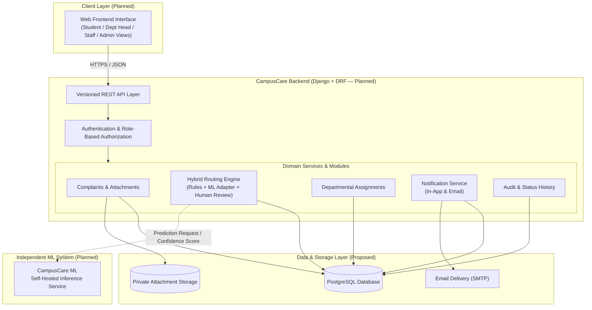

# CampusCare

**A centralized, AI-assisted university complaint management platform designed for the University of Central Asia, Naryn Campus.**

---

## Development Status

**Project Status:** Actively Under Development  
**Current Phase:** Requirements Specification, System Architecture, and Environment Setup  
**Project Type:** Full-Stack Web Application with Independent Machine Learning Integration  
**Institutional Context:** University of Central Asia (UCA) — Naryn Campus

> **Note:** CampusCare is currently in the architecture and planning stage. All application modules, user workflows, and machine learning integrations described below represent **planned capabilities** under active engineering design unless explicitly marked as completed.

---

## Project Overview

**CampusCare** is a centralized digital platform designed to modernize how university students report campus issues and how administrative departments receive, route, assign, track, and resolve them.

Instead of requiring students to manually determine which administrative office handles a specific problem—such as damaged dormitory furniture, network outages, malfunctioning access cards, campus safety concerns, or academic administration inquiries—CampusCare provides a unified submission interface backed by hybrid routing (deterministic rules, self-hosted machine learning classification, and human oversight).

Once a complaint is routed to the appropriate department, the platform supports structured departmental workflows: department heads receive notifications and assign issues to individual staff members, assigned staff record progress updates and resolutions, and students monitor the status of their submissions from creation to closure.

*CampusCare is an independently developed student software engineering project and is not an officially endorsed or deployed University of Central Asia system.*

---

## Problem Statement

Traditional university complaint-handling processes frequently rely on fragmented communication channels such as ad-hoc emails, walk-in visits, or informal messaging. These fragmented workflows create recurring operational challenges:

- **Unclear Reporting Channels:** Students often do not know which office or staff member is responsible for resolving a specific campus issue.
- **Misrouted Complaints:** Issues sent to the wrong department experience delays or go unanswered during manual forwarding.
- **Inconsistent Record-Keeping:** Without a centralized system of record, complaint details, photographs, and resolution histories are scattered across individual inboxes.
- **Limited Status Visibility:** Students lack transparent visibility into whether their complaint has been received, assigned, or resolved, leading to repeated follow-up inquiries.
- **Unclear Ownership and Accountability:** Department leaders lack structured tools to delegate complaints to individual staff members and monitor resolution bottlenecks.
- **Lack of Operational Insights:** University administrators cannot easily audit systemic campus issues or evaluate departmental response metrics.

CampusCare addresses these challenges by establishing a structured, auditable, and transparent lifecycle for every campus complaint.

---

## Project Objectives

1. **Centralize Complaint Submission:** Provide students with a single, accessible web interface to submit campus issues using text descriptions and optional photographic evidence.
2. **Streamline Departmental Routing:** Assist in identifying the responsible university department through a hybrid routing pipeline combining deterministic rules, machine learning predictions, and human review.
3. **Establish Structured Departmental Workflows:** Enable department heads to review incoming complaints, receive timely alerts, and assign tasks to individual department staff members.
4. **Ensure Transparent Progress Tracking:** Allow students to track real-time status transitions and student-visible progress updates while keeping internal operational notes restricted to authorized staff.
5. **Maintain an Auditable System of Record:** Record every status transition, routing decision, and staff assignment to support institutional accountability.
6. **Enforce Role-Based Security and Privacy:** Protect student records, complaint descriptions, and uploaded attachments through strict backend access controls.
7. **Support Modular ML Integration:** Consume department predictions from an independently trained, self-hosted classification system (**CampusCare ML**) without relying on external commercial AI APIs or compromising core platform availability when inference is offline.

---

## Core Planned Features

All features listed below are currently **planned** as part of the system design specification.

### Student Features (Planned)
- **Account Registration and Authentication:** Secure student registration and login.
- **Text-Only Complaint Submission:** Submit detailed written reports describing campus issues and their locations.
- **Photo-Assisted Complaint Submission:** Attach one or more optional photographs (e.g., broken fixtures, facility damage, IT error screens) to provide visual context.
- **Complaint History:** View a centralized list of all previously submitted complaints.
- **Progress Tracking & Status Updates:** Monitor complaint lifecycle stages and read official updates recorded by assigned department staff.

### Department Head Features (Planned)
- **Department-Specific Dashboard:** View and filter complaints routed specifically to the department they lead.
- **Incoming Complaint Management:** Receive, review, and validate newly routed complaints.
- **Dashboard and Email Notifications:** Receive automated in-app dashboard alerts and email notifications when new complaints arrive or require attention.
- **Staff Assignment:** Assign and reassign complaints to eligible individual staff members within the department.
- **Resolution Monitoring:** Track staff workload, active assignments, and overall resolution progress across the department.

### Department Staff Features (Planned)
- **Assigned Work Queue:** View complaints explicitly assigned to the staff member by their department head.
- **Status Management:** Update complaint statuses as work progresses from assignment to resolution.
- **Progress and Resolution Logging:** Record student-visible progress updates, internal departmental notes, and final resolution details.

### Administrator Features (Planned)
- **User and Department Management:** Manage authorized platform accounts, staff memberships, and controlled department records.
- **Cross-Departmental Oversight:** Monitor complaint volumes, routing decisions, and resolution statuses across all university departments.
- **Operational Auditing:** Review system activity logs, manual routing overrides, and administrative events.
- **Access Permission Governance:** Enforce and manage role-based access permissions across the platform.

### Intelligent Routing (Planned)
- **Automated Department Prediction:** Predict the responsible administrative department using independently trained machine learning models from **CampusCare ML**, alongside deterministic routing rules.
- **Text and Multimodal Classification:** Support initial text-only complaint classification with planned expansion to multimodal (text + image) classification.
- **Confidence Estimation:** Record model confidence scores and model version metadata alongside every routing prediction.
- **Human-in-the-Loop Fallback:** Automatically flag low-confidence, ambiguous, or unsupported predictions for manual human review so complaints are never silently misrouted.

---

## User Roles and Responsibilities

CampusCare enforces strict role-based access control (RBAC) on the backend across four primary application roles:

| Role | Primary Scope | Key Planned Responsibilities |
| :--- | :--- | :--- |
| **Student** | Personal submissions | Create text or text-and-photo complaints, view personal submission history, and track resolution progress. |
| **Department Head** | Single assigned department | Review incoming departmental complaints, receive dashboard and email alerts, assign complaints to department staff, and oversee departmental resolution. |
| **Department Staff** | Assigned complaints | Work on complaints assigned by the Department Head, update status stages, and document progress and resolution outcomes. |
| **Administrator** | System-wide | Manage users, roles, and departments; review cross-departmental operations; handle routing exceptions; and audit platform activity. |

---

## Administrative Departments

CampusCare initially supports five core university departments modeled around campus operations at UCA Naryn:

| # | Department | Internal Identifier | Typical Complaint Scope |
| :- | :--- | :--- | :--- |
| 1 | **Maintenance & Facilities** | `maintenance-facilities` | Classroom and dormitory furniture, plumbing, heating, lighting, electrical fixtures, and physical building maintenance. |
| 2 | **IT Department** | `it` | Campus Wi-Fi and network connectivity, computer labs, classroom AV equipment, institutional accounts, and technical support. |
| 3 | **Security** | `security` | Campus safety concerns, malfunctioning student access cards, building access control, and security incidents. |
| 4 | **Academic Administration** | `academic-administration` | Course scheduling, classroom allocation, academic records, examination logistics, and registrar-related inquiries. |
| 5 | **Student Affairs** | `student-affairs` | Residential life, dormitory policies, student services, campus dining feedback, and student welfare support. |

### Departmental Assignment Workflow
When a complaint is routed to one of the five departments, the **Department Head** receives an in-app and email notification. Department Heads are solely responsible for reviewing the complaint and assigning it to an eligible **Department Staff** member within their department. Staff members cannot self-assign complaints unless explicitly authorized by administrative policy, ensuring clear operational oversight and accountability.

---

## Proposed System Architecture

CampusCare follows a **modular monolith** architecture powered by a Django backend and versioned REST APIs. This design provides clean separation of concerns between presentation, business logic, data persistence, and external ML inference without the operational overhead of premature microservices.

### Architectural Highlights
- **Presentation & API Separation:** The frontend communicates with the Django backend through structured, versioned REST APIs, while all security permissions and state transitions are enforced server-side.
- **Modular Backend Domains:** Logical separation across `accounts`, `departments`, `complaints`, `routing`, `assignments`, `notifications`, `audit`, and `reports`.
- **Resilient ML Integration:** The backend communicates with the self-hosted **CampusCare ML** inference interface through an adapter layer. If the ML component is unavailable or returns a low-confidence score, CampusCare gracefully falls back to deterministic rules and human routing review.

---

## Relationship to CampusCare ML

CampusCare is designed to integrate with an independent companion machine learning research and engineering project: **CampusCare ML**.

- **Planned Repository:** [https://github.com/meahmadkarim/campuscare-ml](https://github.com/meahmadkarim/campuscare-ml) *(Repository planned — not yet verified/published)*

### Separation of Responsibilities

| Dimension | CampusCare (This Repository) | CampusCare ML (Companion Project — Planned) |
| :--- | :--- | :--- |
| **Primary Focus** | Full-stack web application and operational workflows | Machine learning research, dataset curation, and model training |
| **Core Responsibilities** | User accounts, role-based access, complaint submission, photo handling, department dashboards, staff assignments, database persistence, and notifications | Dataset construction, NLP text classification, multimodal (text + image) neural network training, model evaluation, confidence calibration, and self-hosted inference |
| **External AI APIs** | None required for core operations | None — models are trained and evaluated independently without commercial third-party AI APIs (no OpenAI, Gemini, or Claude API dependencies) |
| **Integration Contract** | Sends complaint text (and future image inputs) to the inference interface; validates returned department predictions and confidence scores; routes uncertain cases to human review | Exposes a versioned, self-hosted inference interface returning predicted department, category, confidence score, and model version |

---

## Technology Stack

To maintain clear architectural governance, technologies are categorized below by their current decision status (**Confirmed** vs. **Proposed / Under Evaluation**).

| Layer | Technology | Status | Role in CampusCare |
| :--- | :--- | :--- | :--- |
| **Backend Framework** | Python, Django, Django REST Framework | Confirmed / Primary | Core application framework, object-oriented domain logic, ORM, authentication, and REST API layer. |
| **Database** | PostgreSQL | Proposed (Recommended) | Relational storage for users, departments, complaints, assignments, routing history, notifications, and audit logs. |
| **Frontend** | React, TypeScript, Vite *(or Django Templates)* | Proposed | Role-specific user interfaces, client-side form validation, and status dashboards (final selection pending specification sign-off). |
| **File Storage** | Private Server / Object Storage | Proposed | Protected storage for student-uploaded complaint photographs, referenced via database metadata. |
| **Notifications** | Database-backed In-App + SMTP Email | Proposed | Dashboard alerts and email notifications for department heads with delivery tracking and retry handling. |
| **ML Inference** | CampusCare ML (Self-Hosted Interface) | Planned | Independent local/self-hosted model inference for automated complaint classification. |
| **Version Control** | Git & GitHub (Isolated Git Worktrees) | Confirmed | Source control, multi-agent branch isolation, and structured code review. |

---

## Development Roadmap

The following checklist tracks the major engineering milestones for CampusCare. Items are marked as completed only when verified in the repository codebase.

- [ ] **Requirements and architecture** *(In progress: `AGENTS.md` governance and `docs/ROADMAP.md` established; formal `PROJECT_SPEC.md` and database schema sign-off pending)*
- [ ] **Project setup** *(Django project scaffolding, dependency pinning, and local environment configuration)*
- [ ] **Authentication and user roles** *(Custom user model, role permissions for Student, Department Head, Staff, and Administrator)*
- [ ] **Student complaint submission** *(Text and optional photo complaint creation, attachment validation, and student tracking views)*
- [ ] **Department dashboards** *(Department-scoped queues, filtering, and oversight interfaces for the five campus departments)*
- [ ] **Staff assignment and complaint tracking** *(Department head assignment workflows, staff status updates, and immutable status history)*
- [ ] **Email and dashboard notifications** *(In-app notification center, SMTP email dispatch, and delivery status tracking)*
- [ ] **ML service integration** *(Integration adapter for CampusCare ML predictions, confidence thresholds, and human fallback routing)*
- [ ] **Testing and security** *(Unit, integration, and permission-boundary test suites; attachment access control verification)*
- [ ] **Deployment and documentation** *(Production-ready configuration, API documentation, and setup guides)*

For granular phase breakdowns, see [`docs/ROADMAP.md`](docs/ROADMAP.md).

---

## Current Project Progress

**Current Repository State:** Architecture Planning & Documentation Phase

### Verified in Repository
- **Project Governance & Architecture Specification (`AGENTS.md`):** Comprehensive engineering specification defining functional requirements, domain boundaries, proposed relational data models, role-based access rules, hybrid routing workflows, and security constraints.
- **Development Roadmap (`docs/ROADMAP.md`):** Multi-phase engineering plan outlining deliverables across backend, frontend, database, notifications, ML integration, and testing.
- **Workspace & Version Control Configuration:** Git repository initialized with multi-agent worktree conventions and workspace configuration.

### Not Yet Implemented
- Backend Django application code and database migrations
- Frontend user interfaces
- Authentication, complaint submission, and notification services
- Integration with the CampusCare ML inference service

---

## Future Enhancements

Beyond the initial core release, planned long-term enhancements include:

1. **Multimodal (Text + Image) Classification:** Extending the CampusCare ML integration to jointly analyze complaint descriptions and uploaded photographs for higher routing accuracy.
2. **Departmental Analytics and SLA Reporting:** Interactive administrative reports measuring response times, resolution rates, and recurring facility bottlenecks across campus locations.
3. **Active Learning Feedback Loop:** Capturing manual routing overrides made by administrators and department heads as labeled feedback data to retrain and improve CampusCare ML models.
4. **Multi-Language Support:** Localization support for campus community members.
5. **Mobile-First Responsive Experience:** Optimizing field usage so students can photograph and report campus issues directly from mobile browsers, and maintenance staff can update assignments on site.

---

## Security and Privacy Considerations

Because campus complaints may involve residential facilities, academic concerns, or security matters, CampusCare is designed around strict security and privacy principles:

- **Backend-Enforced Role Authorization:** Every API endpoint and state transition enforces role-based and department-scoped permissions on the server; frontend views are never relied upon as a security boundary.
- **Protected Complaint Attachments:** Student-uploaded photographs will be stored in private storage rather than public static directories, with strict validation of file types, sizes, and download authorization.
- **Visibility Separation:** Internal departmental notes recorded by staff or department heads are strictly isolated from student-facing APIs and views.
- **Data Minimization:** Student profiles and audit logs store only essential operational fields, avoiding unnecessary collection or duplication of personally identifiable information (PII).
- **Secure Credential Handling:** User authentication relies on Django's battle-tested password hashing and session/token management mechanisms.

---

## Project Disclaimer

**CampusCare is an independent student software engineering project developed for educational, research, and portfolio purposes within the context of the University of Central Asia, Naryn Campus.**

- It is **not** an official, endorsed, or deployed information system of the University of Central Asia.
- References to UCA Naryn campus departments and workflows are used solely to model realistic institutional domain requirements.

---

## License & Contact

- **Author / Maintainer:** Ahmad Karim
- **GitHub Repository:** [github.com/meahmadkarim/CampusCare](https://github.com/meahmadkarim/CampusCare)
- **Planned ML Companion Repository:** [github.com/meahmadkarim/campuscare-ml](https://github.com/meahmadkarim/campuscare-ml) *(Planned)*
